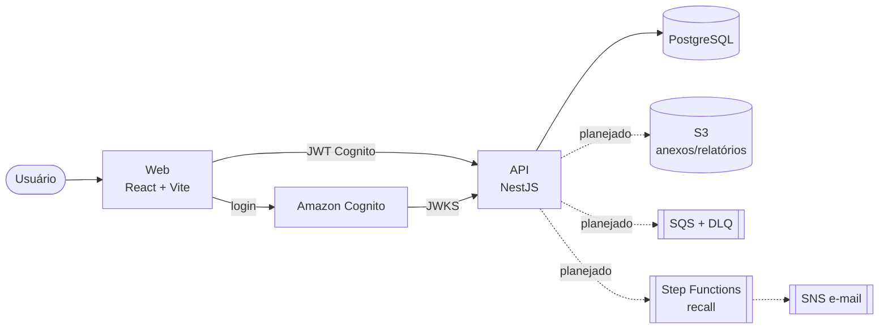

# Arquitetura

> Documento vivo: as seções marcadas como _planejado_ ainda não foram implementadas.

## Visão geral

## Monorepo

| Pasta             | Papel                                                                     |
| ----------------- | ------------------------------------------------------------------------- |
| `apps/api`        | API NestJS 12 (ESM), prefixo `/v1`, Swagger em `/docs`                    |
| `apps/web`        | Front React (_Semana 1, etapa 9_)                                         |
| `packages/shared` | Constantes de domínio (perfis, enums) e, depois, o cliente tipado OpenAPI |
| `infra`           | Terraform: módulos e ambiente `prod` ([deploy.md](deploy.md))             |
| `docs`            | Esta documentação e os ADRs                                               |

O pacote `shared` é compilado com **tsup** em ESM + CJS: a API Nest (CommonJS) e o front Vite (ESM) consomem o mesmo artefato sem configuração especial.

## Fluxo de uma requisição (planejado para a Semana 1)

1. `nestjs-pino` lê `x-request-id` (ou gera um UUID) e devolve no header de resposta — **ID de correlação**.
2. `JwtAuthGuard` valida o token pela JWKS (Cognito em produção, emissor simulado em dev).
3. O usuário é carregado pelo `sub`; `companyId` e perfis vão para o contexto da requisição (`nestjs-cls`).
4. `RolesGuard` checa `@Roles(...)`.
5. O serviço usa o Prisma **estendido**, que injeta `company_id` em todo `where`/`data` — veja [ADR 0004](adr/0004-multi-tenancy.md).
6. Erros saem no formato RFC 9457 (`application/problem+json`).

## Deploy na AWS

Implementado em `infra/terraform/` — roteiro, custos e diagrama em [deploy.md](deploy.md). Resumo (com a mudança de rede do [ADR 0010](adr/0010-rede-e-custos-aws.md): Lambdas fora da VPC, RDS público com TLS obrigatório; o modo na VPC fica atrás de `private_networking`):

- API: Lambda (NestJS via serverless-express, bundle com esbuild) atrás de API Gateway HTTP API.
- Web: S3 privado + CloudFront com OAC.
- Banco: RDS PostgreSQL 17 `db.t4g.micro`, uma AZ, TLS obrigatório; API com concorrência limitada; VPC **sem NAT Gateway** (endpoint de gateway para S3).
- Assíncrono: SQS (DLQ dos jobs), Step Functions (recall), EventBridge Scheduler (alerta de validade), SNS (notificações).
- Módulo alternativo ECS Fargate + ALB + WAF apenas com `terraform validate`.
- Migrations: Lambda `migrate` invocada pelo workflow de deploy ([ADR 0011](adr/0011-lambda-esbuild-migrations.md)).
