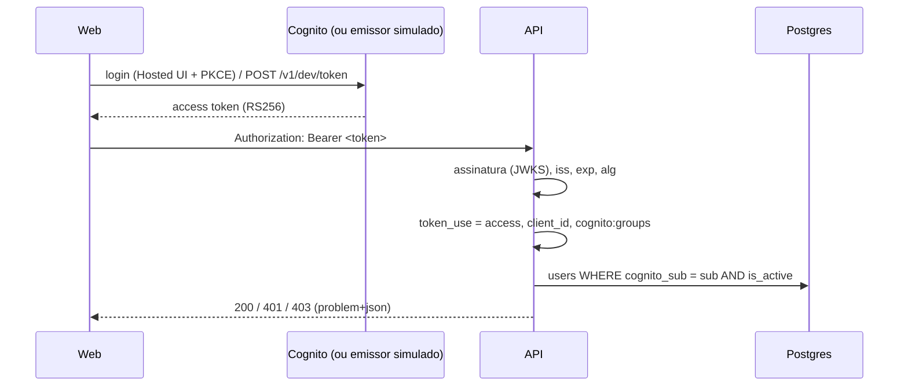

# Autenticação e perfis

Decisão: [ADR 0005](adr/0005-auth-cognito-mock-issuer.md). Código: `apps/api/src/auth/`.

## Fluxo



## Regras

- **Tudo exige token**, exceto rotas com `@Public()` (health e o emissor simulado). Isso é um guard global — esquecer de proteger uma rota nova não a deixa aberta.
- Validação em duas camadas:
  1. `passport-jwt`: assinatura RS256, emissor e expiração.
  2. `parseAccessTokenClaims`: `token_use` precisa ser `access` (um ID token é recusado), `client_id` precisa ser o do app e `sub` precisa existir.
- O usuário precisa estar cadastrado e **ativo** — desativar alguém corta o acesso mesmo com token ainda válido.
- **Perfis vêm do token** (`cognito:groups`), não do banco. Grupos desconhecidos são ignorados.
- `@Roles('admin', 'operator')` restringe a rota; sem `@Roles`, qualquer usuário autenticado passa.

| Situação                                         | Resposta |
| ------------------------------------------------ | -------- |
| Sem token, token malformado, assinatura inválida | 401      |
| Expirado, ID token, outro `client_id`            | 401      |
| Usuário inexistente ou inativo                   | 401      |
| Autenticado, mas sem o perfil exigido            | 403      |

## Modos (`AUTH_MODE`)

| Modo      | Chave pública                                                     | Quando                   |
| --------- | ----------------------------------------------------------------- | ------------------------ |
| `cognito` | JWKS do User Pool (`jwks-rsa`, com cache e limite de requisições) | AWS (padrão)             |
| `mock`    | Par RSA gerado em memória ao subir a API                          | Desenvolvimento e testes |

A estratégia é **a mesma** nos dois modos; muda só a origem da chave. O env **recusa** `AUTH_MODE=mock` com `NODE_ENV=production`, e os endpoints `/v1/dev/*` só são registrados em modo mock.

### Endpoints do emissor simulado

| Método e rota                       | O que faz                                                            |
| ----------------------------------- | -------------------------------------------------------------------- |
| `GET /v1/dev/users`                 | Usuários ativos (e-mail, nome, perfis, empresa) para a tela de login |
| `POST /v1/dev/token` `{ "email" }`  | Access token de 1 h no formato do Cognito                            |
| `GET /v1/dev/.well-known/jwks.json` | Chave pública do emissor (formato JWKS)                              |

Reiniciar a API gera um novo par de chaves: tokens antigos deixam de valer.

### Testando pelo terminal

```bash
TOKEN=$(curl -s -X POST localhost:3000/v1/dev/token \
  -H 'content-type: application/json' -d '{"email":"bruno@serraazul.dev"}' | jq -r .accessToken)
curl -s localhost:3000/v1/me -H "Authorization: Bearer $TOKEN"
```

No Swagger (`/docs`), use **Authorize** e cole o token.

## Configuração

| Variável               | Modo      | Descrição                               |
| ---------------------- | --------- | --------------------------------------- |
| `AUTH_MODE`            | ambos     | `cognito` (padrão) ou `mock`            |
| `COGNITO_CLIENT_ID`    | ambos     | `client_id` esperado nos tokens         |
| `COGNITO_REGION`       | `cognito` | Região do User Pool                     |
| `COGNITO_USER_POOL_ID` | `cognito` | ID do User Pool (define emissor e JWKS) |
