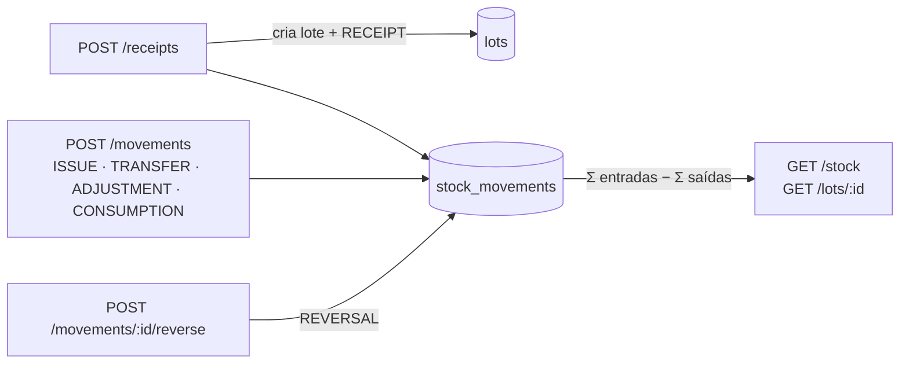

# Lotes e estoque (API)

Decisão: [ADR 0007](adr/0007-razao-de-estoque.md). Código: `apps/api/src/modules/inventory/`.

## Conceitos

- **Lote**: unidade rastreável (`CAF-2026-000123`). Nasce no recebimento (e, na Semana 3, na produção). Guarda produto, fornecedor, validade, quantidade original e os dados de qualidade do café.
- **Razão de estoque**: toda entrada, saída e transferência é uma linha imutável. O saldo é **calculado** do razão.
- **Estorno**: a única forma de corrigir — nova linha com origem e destino invertidos.



## Rotas

| Método e rota                    | Perfis                                                | Descrição                                                                                                      |
| -------------------------------- | ----------------------------------------------------- | -------------------------------------------------------------------------------------------------------------- |
| `POST /v1/receipts`              | admin, operador                                       | Recebimento: cria o lote (código automático) e a entrada. Aceita `Idempotency-Key`                             |
| `GET /v1/lots`                   | todos                                                 | Lista com saldo total. Filtros: `q` (código), `productId`, `supplierId`, `status`, `expiresWithinDays`; `sort` |
| `GET /v1/lots/:id`               | todos                                                 | Detalhe com saldo por local                                                                                    |
| `PATCH /v1/lots/:id`             | admin, operador                                       | Corrige validade e dados de qualidade (código, produto e quantidade não mudam)                                 |
| `PATCH /v1/lots/:id/status`      | quarentena: admin, operador · bloquear/liberar: admin | `{ status, reason }`; `CONSUMED` é automático                                                                  |
| `POST /v1/movements`             | admin, operador (ajuste: só admin)                    | `ISSUE`, `TRANSFER`, `ADJUSTMENT` (motivo obrigatório), `CONSUMPTION`. Aceita `Idempotency-Key`                |
| `POST /v1/movements/:id/reverse` | admin                                                 | Estorno `{ reason }`                                                                                           |
| `GET /v1/movements`              | todos                                                 | Histórico. Filtros: `lotId`, `locationId`, `type`, `from`, `to`                                                |
| `GET /v1/stock`                  | todos                                                 | Posição: saldo por lote e local. Filtros: `productId`, `locationId`, `lotStatus`, `q`                          |

## Direção de cada tipo

| Tipo          |         Origem         | Destino | Uso                                             |
| ------------- | :--------------------: | :-----: | ----------------------------------------------- |
| `RECEIPT`     |           —            |    ✔    | Recebimento de fornecedor                       |
| `ISSUE`       |           ✔            |    —    | Venda/expedição                                 |
| `TRANSFER`    |           ✔            |    ✔    | Mudança de local                                |
| `ADJUSTMENT`  |      um dos dois       |         | Perda (origem) ou sobra (destino) de inventário |
| `CONSUMPTION` |           ✔            |    —    | Consumo em produção                             |
| `PRODUCTION`  |           —            |    ✔    | Lote produzido (Semana 3)                       |
| `REVERSAL`    | invertidos da original |         | Estorno                                         |

## Regras

- Quantidades: string decimal positiva com até 3 casas (`"60"`, `"1250.500"`), na unidade do produto.
- **Saldo insuficiente** → `409 /problems/insufficient-stock` com `available`, `requested` e `location`.
- **Lote em quarentena ou bloqueado** não sai nem é transferido → `409 /problems/lot-not-movable` (exceção: lote em quarentena indo para um local do tipo quarentena).
- Recebimento num local de quarentena cria o lote já em `QUARANTINE`.
- Saldo total zerado → `CONSUMED`; estorno que repõe saldo → `AVAILABLE`.
- Estorno: uma vez por movimentação; estorno de estorno é proibido; precisa haver saldo no local de onde sai.
- **Idempotência**: repetir com a mesma `Idempotency-Key` devolve o resultado original e o header `Idempotent-Replayed: true`; mesma chave com outro corpo → `422 /problems/idempotency-key-reused`.
- Produto ou destino inativo → 409. Lote, local ou fornecedor de outra empresa → 404.

## Garantias no banco

- Trigger `stock_movements_no_update_delete`: `UPDATE`/`DELETE` em `stock_movements` falham para qualquer cliente.
- `CHECK`: quantidade > 0, origem ou destino presente, origem ≠ destino, faixas de peneira/umidade/pontuação.
- FKs compostas `(company_id, …)`: lote → produto, movimentação → lote e usuário, anexo → lote.

## Exemplo

```bash
curl -X POST localhost:3000/v1/receipts -H "Authorization: Bearer $TOKEN" \
  -H 'content-type: application/json' -H 'Idempotency-Key: nf-004512' \
  -d '{"productId":"…","supplierId":"…","locationId":"…","quantity":"60",
       "harvest":"2025/26","variety":"Bourbon Amarelo","cuppingScore":86.25,
       "moisturePercent":11.5,"expiresAt":"2027-06-30","documentRef":"NF 004512"}'
```
