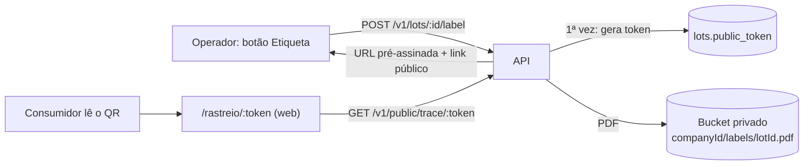

# Etiqueta do lote e página pública de rastreio

Código: `apps/api/src/modules/labels/` (etiqueta), `apps/api/src/public/` (rota pública), `apps/api/src/modules/trace/public-origin.ts` (o que é publicável) e `apps/web/src/features/public-trace/` (página).

## Fluxo

## Etiqueta (PDF)

`POST /v1/lots/:id/label` — admin e operador (auditor: 403; lote de outra empresa: 404).

- Página **100 × 150 mm** (etiqueta térmica comum), gerada com `pdf-lib`; QR code **vetorial** (`qrcode`, correção M), nítido em impressora térmica.
- Conteúdo: empresa, produto, **código do lote em destaque**, safra, variedade, grau de torra, data (“Recebido em” para café verde, “Torrado em” para torrado, “Produzido em” para blend/embalado — é o `receivedAt` do lote), validade, pontuação SCA, até 4 origens (fazenda + região · cidade/UF · altitude) e o QR code com a URL impressa ao lado.
- Fonte Helvetica padrão do PDF (codificação WinAnsi): cobre os acentos do português (ã, é, ç, ô…). Caracteres fora dela são trocados pela versão sem acento.
- O PDF é gravado em `{companyId}/labels/{lotId}.pdf` (sobrescrito a cada geração) e devolvido como URL pré-assinada de curta duração (`ATTACHMENT_URL_TTL_SECONDS`), com `Content-Disposition: inline` para abrir numa aba.
- Resposta: `{ url, expiresAt, publicUrl }`. Sem bucket configurado → **503**, como nos anexos.

Na tela do lote, o botão **Etiqueta** gera o PDF, abre numa nova aba e mostra o link público com botão de copiar.

## Token público

- Gerado **na primeira etiqueta** do lote: 16 bytes aleatórios (`crypto.randomBytes`) em base64url → 22 caracteres, 128 bits de entropia.
- **Nunca muda** depois: etiquetas já impressas continuam válidas ao regenerar. A gravação é condicional (`WHERE public_token IS NULL`), então duas gerações simultâneas não produzem tokens diferentes.
- Não é o `id` nem o código do lote: não dá para adivinhar nem **enumerar** lotes (o código `CAF-2026-000013` é sequencial; o token não).
- A rota pública só consulta o banco se o token tiver o formato esperado (`[A-Za-z0-9_-]{16,40}`). Token desconhecido → **404** (`Código de rastreio não encontrado` na página).

## Rota pública

`GET /v1/public/trace/:token` — `@Public()`, sem login.

Não há empresa no contexto de uma requisição anônima, e o cliente escopado (`TenantPrismaService`) recusa consultas sem empresa. Por isso o módulo fica em `apps/api/src/public/`, **fora de `src/modules/`** (onde o ESLint proíbe o `PrismaService` cru): o cliente cru faz **uma** consulta — lote pelo token → `id` e `companyId` — e todo o resto roda em `TenantContext.runAs(companyId, …)`, reutilizando `TraceService.backward` com o mesmo isolamento de uma requisição autenticada.

### O que é público e o que não é

| Público                                                              | Nunca exposto                                         |
| -------------------------------------------------------------------- | ----------------------------------------------------- |
| Nome da empresa, produto e tipo, código do lote                      | `id`s internos (só códigos de lote)                   |
| Safra, variedade, torra, data de produção, validade, pontuação SCA   | Quantidades, saldos, locais de estoque                |
| Status como **Disponível / Indisponível**                            | Motivo do status (quarentena, bloqueio, recall)       |
| Cadeia de lotes: tipo de produto, etapa, data, safra, variedade      | Ordens de produção, rendimento, usuários, observações |
| Origem: nome da **fazenda**/cooperativa, região, cidade/UF, altitude | Nome pessoal de produtor, CPF/CNPJ, e-mail, telefone  |
| —                                                                    | Clientes e expedições                                 |

**Por que (LGPD):** produtor rural (`SupplierType.PRODUCER`) é pessoa física. O nome dele é dado pessoal e não tem por que sair da empresa: a página mostra o nome da fazenda (`farmName`); sem fazenda cadastrada, mostra só a região/cidade (“Produtor de Mantiqueira de Minas”). Fornecedores pessoa jurídica (fazenda, cooperativa, trader) sem `farmName` aparecem pelo nome. Documentos e contatos nunca são copiados — a regra está em um só lugar (`toPublicOrigin`), usada pela etiqueta e pela página.

O contrato da resposta (`PublicTraceResponse`) é uma classe própria, montada campo a campo: um campo novo no rastreio interno não vaza para a página por acidente.

### Limite de requisições

`@nestjs/throttler` aplicado **só no controller público**: 30 requisições por minuto por IP (cabeçalhos `X-RateLimit-*-public`; excedeu → **429**, a página pede para aguardar um minuto). O armazenamento é em memória, por instância — suficiente para conter abuso simples. Atrás de API Gateway/CloudFront será preciso confiar no proxy (`trust proxy`) para o IP real chegar ao `req.ip`.

## Página pública (web)

Rota `/rastreio/:token`, fora do layout autenticado. Pensada para o celular: cabeçalho escuro com produto, código, status e ficha técnica; seção **Origem** (fazendas, região, cidade/UF, altitude); linha do tempo **Do grão à xícara** (colheita e recebimento → beneficiamento → torra → blend → embalagem, conforme as etapas da cadeia); rodapé “Rastreado com TraceFlow”.

Usa um cliente HTTP próprio (mesmo contrato tipado), que **nunca envia o token** de quem estiver logado e não tem `onUnauthorized` — um erro aqui nunca encerra sessão nem redireciona para o login.

## Configuração

| Variável         | Onde | Padrão                  | Uso                                                  |
| ---------------- | ---- | ----------------------- | ---------------------------------------------------- |
| `PUBLIC_WEB_URL` | API  | `http://localhost:5173` | Base do QR code: `{PUBLIC_WEB_URL}/rastreio/{token}` |
| `S3_*`           | API  | —                       | Mesmo bucket dos anexos ([anexos.md](anexos.md))     |
