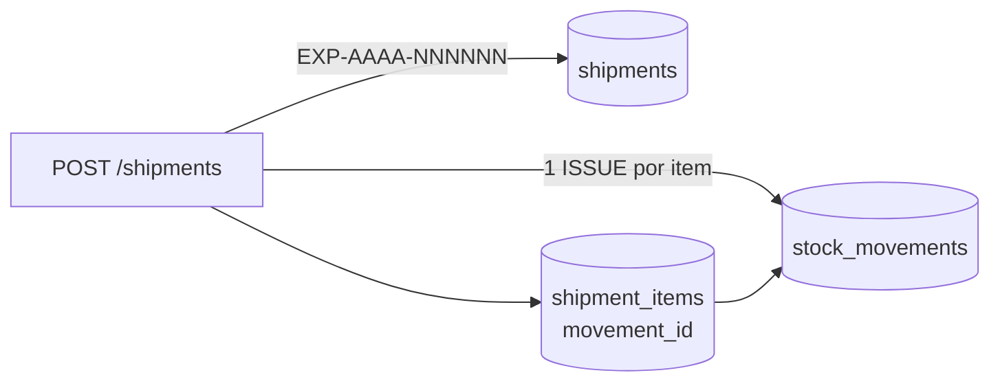

# Expedição (API)

Código: `apps/api/src/modules/shipments/`. Base: razão de estoque ([estoque.md](estoque.md), [ADR 0007](adr/0007-razao-de-estoque.md)).

## Conceitos

- **Expedição**: documento de saída para um cliente, numerado por empresa e ano (`EXP-2026-000001`), com a referência do pedido/NF (`orderRef`) e observações.
- **Item**: um par (lote, local) e a quantidade que sai dele. Cada item gera **uma saída (`ISSUE`)** no razão, com `documentRef` = número da expedição; o item guarda o `movementId`.
- Expedição e itens são **imutáveis**: não existe `PATCH` nem `DELETE`.



## Rotas

| Método e rota           | Perfis          | Descrição                                                                                        |
| ----------------------- | --------------- | ------------------------------------------------------------------------------------------------ |
| `POST /v1/shipments`    | admin, operador | Cria a expedição e as saídas. Aceita `Idempotency-Key`                                           |
| `GET /v1/shipments`     | todos           | Lista paginada, mais recentes primeiro. Filtros: `customerId`, `lotId`, `from`, `to` (data), `q` |
| `GET /v1/shipments/:id` | todos           | Detalhe com cliente, itens (lote, produto, local, quantidade, unidade, `movementId`) e usuário   |

- `lotId` na listagem: expedições que contêm o lote (útil para rastreabilidade "para frente").
- `q`: busca no número (`EXP-…`) ou no `orderRef`.
- `from` (inclusive) e `to` (exclusive) filtram `shippedAt`.

### Corpo do `POST`

```json
{
  "customerId": "…",
  "orderRef": "Pedido 2026-0457",
  "shippedAt": "2026-10-15T14:00:00Z",
  "notes": "Entrega na loja do centro",
  "items": [
    { "lotId": "…", "locationId": "…", "quantity": "2" },
    { "lotId": "…", "locationId": "…", "quantity": "1.5" }
  ]
}
```

`orderRef`, `shippedAt` (padrão: agora) e `notes` são opcionais. De 1 a 50 itens.

## Regras

- **Tudo ou nada**: cliente, numeração, expedição e todas as saídas acontecem numa única transação. Qualquer erro (saldo, status do lote, local inexistente) desfaz tudo — nem a expedição, nem as saídas anteriores ficam gravadas, e o número não é consumido.
- Cliente inexistente (ou de outra empresa) → `404`; cliente inativo → `409 /problems/inactive-customer`.
- Lote ou local inexistente → `404`.
- Par (lote, local) repetido no mesmo pedido → `400 /problems/invalid-shipment` (some as quantidades num item só).
- **Saldo insuficiente** → `409 /problems/insufficient-stock`; **lote em quarentena ou bloqueado** → `409 /problems/lot-not-movable`. As regras são as do razão (`StockLedgerService.record()`), que trava o lote com `SELECT ... FOR UPDATE` antes de conferir o saldo.
- Lote que zera o saldo passa a `CONSUMED` automaticamente.
- **Idempotência**: mesmas regras do recebimento — repetir com a mesma `Idempotency-Key` devolve a expedição original com `Idempotent-Replayed: true`; mesma chave com outro corpo → `422 /problems/idempotency-key-reused`. A chave fica na expedição (não nas movimentações); requisições simultâneas com a mesma chave esbarram no índice único `(company_id, idempotency_key)` e a perdedora devolve a expedição da vencedora.

## Ordem de travamento (sem deadlock)

Antes de lançar as saídas, os itens são **ordenados por `lotId` e depois por `locationId`**. Como cada saída trava a linha do lote (`FOR UPDATE`) até o fim da transação, duas expedições concorrentes que tocam os mesmos lotes sempre pedem os travamentos na mesma ordem: uma espera a outra terminar em vez de cada uma segurar um lote que a outra precisa (deadlock). A ordem dos itens no corpo da requisição não importa.

## Correção: cancelamento ou estorno do item

Expedições não são editadas. Há duas formas de corrigir ([ADR 0013](adr/0013-cancelamento-de-operacoes.md)):

- **Cancelar a expedição inteira** (devolução total, cliente errado, lançada em dobro): `POST /v1/shipments/:id/cancel` `{ "reason": "…" }` (só admin, motivo de 5 a 500 caracteres). Numa transação, estorna a saída de cada item ainda não estornado e grava `cancelledAt`, `cancelReason` e quem cancelou. Um segundo cancelamento (inclusive simultâneo) responde 409 `/problems/already-cancelled`.
- **Estornar um item** (devolução parcial, quantidade errada) — a saída dele no razão:

```bash
curl -X POST localhost:3000/v1/movements/<movementId>/reverse \
  -H "Authorization: Bearer $TOKEN" -H 'content-type: application/json' \
  -d '{"reason":"Cliente devolveu 1 saca"}'
```

O estorno (`REVERSAL`, só admin) devolve a quantidade ao local de origem e mantém a mesma `documentRef` (`EXP-…`). A expedição continua no histórico; se for preciso enviar outra quantidade, crie uma nova expedição.

**Efeitos de itens estornados e expedições canceladas**: o detalhe traz `reversal` por item e `cancellation` na expedição (a lista traz `reversedItemsCount`); o rastreio para frente marca o item como `reversed` e **não** conta o cliente como afetado; o recall não manda contatá-lo nem soma a quantidade em "já expedido"; o painel ignora expedições canceladas; o CSV de expedições ganha a coluna "Estornado em".

## Exemplo

```bash
curl -X POST localhost:3000/v1/shipments -H "Authorization: Bearer $TOKEN" \
  -H 'content-type: application/json' -H 'Idempotency-Key: pedido-2026-0457' \
  -d '{"customerId":"…","orderRef":"Pedido 2026-0457",
       "items":[{"lotId":"…","locationId":"…","quantity":"2"}]}'
```
