# TraceFlow — Manual de apresentação e utilização

**Rastreabilidade de lotes de café, do grão à xícara.**

Este manual apresenta o TraceFlow e ensina, passo a passo, como usá-lo no dia a dia. Ele foi escrito para quem vai operar o sistema — gestores, equipe de armazém, torra, qualidade e expedição — e não exige conhecimento técnico.

> **Sobre as imagens deste manual.** Todas as telas são capturas reais da versão atual do sistema (outubro de 2026), feitas num ambiente de demonstração com **dados fictícios** (empresa "Torrefação Serra Azul", clientes e fornecedores inventados). Por isso elas mostram o selo **"Ambiente de desenvolvimento"** no topo e uma tela de entrada com usuários de teste. No ambiente oficial da sua empresa, esse selo não aparece e a entrada é feita com e-mail e senha (veja [Como entrar no sistema](#31-como-entrar-no-sistema)).

---

## Índice

1. [Apresentação](#1-apresentação)
2. [Visão geral das funcionalidades](#2-visão-geral-das-funcionalidades)
3. [Manual de utilização passo a passo](#3-manual-de-utilização-passo-a-passo)
   - 3.1 [Como entrar no sistema](#31-como-entrar-no-sistema)
   - 3.2 [Conhecendo a tela principal](#32-conhecendo-a-tela-principal)
   - 3.3 [Painel](#33-painel)
   - 3.4 [Cadastros: produtos, fornecedores, clientes e locais](#34-cadastros-produtos-fornecedores-clientes-e-locais)
   - 3.5 [Recebimento de café](#35-recebimento-de-café)
   - 3.6 [Lotes](#36-lotes)
   - 3.7 [Detalhe do lote e suas ações](#37-detalhe-do-lote-e-suas-ações)
   - 3.8 [Estoque e movimentações](#38-estoque-e-movimentações)
   - 3.9 [Produção (beneficiamento, torra, blend e embalagem)](#39-produção-beneficiamento-torra-blend-e-embalagem)
   - 3.10 [Expedição para clientes](#310-expedição-para-clientes)
   - 3.11 [Rastreabilidade](#311-rastreabilidade)
   - 3.12 [Etiqueta com QR code e página pública](#312-etiqueta-com-qr-code-e-página-pública)
   - 3.13 [Qualidade: não conformidades](#313-qualidade-não-conformidades)
   - 3.14 [Recall (recolhimento)](#314-recall-recolhimento)
   - 3.15 [Auditoria](#315-auditoria)
   - 3.16 [Relatórios em planilha](#316-relatórios-em-planilha)
   - 3.17 [Importação de cadastros por planilha](#317-importação-de-cadastros-por-planilha)
   - 3.18 [Perfis de acesso: o que cada um pode fazer](#318-perfis-de-acesso-o-que-cada-um-pode-fazer)
   - 3.19 [Uso no celular e tema escuro](#319-uso-no-celular-e-tema-escuro)
4. [Mensagens do sistema e como resolver erros comuns](#4-mensagens-do-sistema-e-como-resolver-erros-comuns)
5. [Dúvidas frequentes](#5-dúvidas-frequentes)
6. [Limitações conhecidas](#6-limitações-conhecidas)
7. [Encerramento](#7-encerramento)
8. [Glossário](#8-glossário)

---

## 1. Apresentação

### O que é o TraceFlow

O TraceFlow é um sistema na internet (acessado pelo navegador, sem instalar nada) para **controlar e rastrear lotes de café** em pequenas e médias torrefações, cooperativas e beneficiadoras. Ele registra cada etapa pela qual o café passa:

**Recebimento do fornecedor → estoque → beneficiamento/torra/blend/embalagem → expedição para o cliente.**

Cada entrada de café vira um **lote** com código próprio (por exemplo, `CAF-2026-000004`). Tudo o que acontece com esse lote fica registrado e ligado aos lotes de origem e aos lotes que foram feitos a partir dele.

### Qual problema ele resolve

Em alimentos, saber **de onde veio** e **para onde foi** cada lote não é luxo: é exigência de qualidade, de clientes exigentes e de órgãos de fiscalização. Sem um sistema, essa informação fica espalhada em planilhas, cadernos e notas fiscais, e responder a uma pergunta simples — "quais clientes receberam café feito com aquele lote de grão verde que deu problema no laudo?" — pode levar dias.

No TraceFlow essa resposta aparece **em segundos**, numa árvore visual, com a lista de clientes e as quantidades enviadas.

### Objetivos e benefícios

| Objetivo                                            | Benefício prático                                                                                              |
| --------------------------------------------------- | -------------------------------------------------------------------------------------------------------------- |
| Saber o saldo de cada lote em cada local            | Fim das divergências de estoque; o sistema não deixa o saldo ficar negativo                                    |
| Registrar a transformação do café                   | Rendimento e perda de cada torra calculados automaticamente                                                    |
| Rastrear para trás (origem) e para frente (destino) | Resposta imediata a auditorias, clientes e fiscalização                                                        |
| Agir rápido em caso de problema                     | Recall que bloqueia o lote e todos os derivados, gera relatório em PDF e lista os clientes a contatar          |
| Mostrar a origem ao consumidor                      | Etiqueta com QR code que abre uma página pública com fazenda, região, altitude e safra                         |
| Ter histórico confiável                             | Nenhuma movimentação é apagada: correções são feitas por estorno, e toda alteração fica na trilha de auditoria |

### Quem pode utilizá-lo e em quais situações

- **Gestores e administradores:** acompanham o painel, liberam lotes, executam recalls, importam cadastros e consultam a auditoria.
- **Operadores (armazém, torra, expedição):** registram recebimentos, movimentações, ordens de produção e expedições.
- **Auditores e equipe de qualidade externa:** consultam tudo, sem poder alterar nada.
- **Consumidores finais:** leem o QR code da embalagem e veem a origem do café, sem precisar de login.

Situações típicas: chegada de um caminhão com sacas de café verde; um dia de torra; montagem de pedidos para cafeterias; visita de auditoria; laudo de laboratório reprovando um lote.

---

## 2. Visão geral das funcionalidades

### Situação de cada recurso

| Recurso                                               | Situação          | Observação                                                                                                                        |
| ----------------------------------------------------- | ----------------- | --------------------------------------------------------------------------------------------------------------------------------- |
| Painel com indicadores                                | ✅ Disponível     |                                                                                                                                   |
| Cadastros (produtos, fornecedores, clientes, locais)  | ✅ Disponível     | Sem exclusão: registros são desativados                                                                                           |
| Recebimento de café e criação de lote                 | ✅ Disponível     |                                                                                                                                   |
| Lotes, estoque por local e histórico de movimentações | ✅ Disponível     |                                                                                                                                   |
| Saída, transferência, consumo, ajuste e estorno       | ✅ Disponível     | Ajuste e estorno só para administrador                                                                                            |
| Anexos no lote (laudos, notas fiscais, fotos)         | ✅ Disponível     | PDF, JPEG, PNG ou WebP até 10 MB                                                                                                  |
| Produção: beneficiamento, torra, blend e embalagem    | ✅ Disponível     |                                                                                                                                   |
| Expedição para clientes                               | ✅ Disponível     |                                                                                                                                   |
| Rastreabilidade visual (origem e destino)             | ✅ Disponível     |                                                                                                                                   |
| Etiqueta em PDF com QR code e página pública          | ✅ Disponível     |                                                                                                                                   |
| Não conformidades (quarentena, liberação, descarte)   | ✅ Disponível     |                                                                                                                                   |
| Recall com simulação, bloqueio, relatório PDF e aviso | ✅ Disponível     | O aviso por e-mail vai para a equipe responsável pelo sistema, não para os clientes (veja [Limitações](#6-limitações-conhecidas)) |
| Alerta de validade (sino no topo)                     | ✅ Disponível     |                                                                                                                                   |
| Trilha de auditoria                                   | ✅ Disponível     |                                                                                                                                   |
| Relatórios em planilha (CSV para Excel)               | ✅ Disponível     |                                                                                                                                   |
| Importação de cadastros por planilha                  | ✅ Disponível     | Só cadastros; lotes e estoque inicial não são importados                                                                          |
| Tema claro/escuro e uso no celular                    | ✅ Disponível     |                                                                                                                                   |
| Cadastro de usuários pela tela                        | ❌ Não disponível | Feito pela equipe técnica (veja [Dúvidas frequentes](#5-dúvidas-frequentes))                                                      |
| Cadastro de novas empresas pela tela                  | ❌ Não disponível | Feito pela equipe técnica                                                                                                         |
| Envio automático de aviso aos clientes no recall      | ❌ Não disponível | O sistema gera a lista de contatos para a sua equipe enviar                                                                       |
| Integração com emissão de nota fiscal ou ERP          | ❌ Não disponível | O número da NF é registrado como texto                                                                                            |

### Resumo de cada módulo

| Módulo (menu)       | O que você faz nele                                                                                                                                     |
| ------------------- | ------------------------------------------------------------------------------------------------------------------------------------------------------- |
| **Painel**          | Vê lotes disponíveis, em quarentena e bloqueados, movimentações do dia, produção e expedições dos últimos 30 dias, lotes vencendo e estoque por produto |
| **Recebimento**     | Registra a chegada de café de um fornecedor; o sistema cria o lote e o saldo inicial                                                                    |
| **Produção**        | Registra beneficiamento, torra, blend ou embalagem: consome lotes de insumo e gera um novo lote ligado a eles                                           |
| **Expedição**       | Registra a saída de café para um cliente, com pedido/NF                                                                                                 |
| **Lotes**           | Lista e detalhe de cada lote: saldo, validade, qualidade, anexos, histórico e ações                                                                     |
| **Estoque**         | Saldo por lote e por local                                                                                                                              |
| **Movimentações**   | Histórico completo (razão) de entradas, saídas, transferências, ajustes e estornos                                                                      |
| **Rastreabilidade** | Árvore visual da fazenda ao cliente                                                                                                                     |
| **Recall**          | Simula o impacto de um problema, bloqueia os lotes afetados e gera o relatório                                                                          |
| **Qualidade**       | Abre, libera ou descarta não conformidades                                                                                                              |
| **Auditoria**       | Quem fez o quê, quando, com o antes e o depois                                                                                                          |
| **Cadastros**       | Produtos, fornecedores, clientes e locais de estoque                                                                                                    |
| **Relatórios**      | Baixa planilhas de estoque, movimentações, produção e expedições                                                                                        |
| **Importação**      | Carrega cadastros em massa a partir de planilha                                                                                                         |

### Integrações existentes

O TraceFlow funciona sozinho; ele **não** se conecta a sistemas de nota fiscal, ERP ou e-commerce. As integrações que existem são de infraestrutura e ficam invisíveis para o usuário:

- **Login seguro** pelo serviço de identidade da Amazon (Amazon Cognito), com troca de senha obrigatória no primeiro acesso.
- **Armazenamento de arquivos** (anexos, etiquetas e relatórios em PDF) num repositório privado na nuvem.
- **Avisos por e-mail** para a equipe responsável quando um recall é executado, quando uma etapa do recall falha e, diariamente, sobre lotes perto de vencer.
- **Planilhas CSV** compatíveis com o Excel em português, para levar os dados a qualquer outra ferramenta.

---

## 3. Manual de utilização passo a passo

### 3.1 Como entrar no sistema

**No ambiente oficial da sua empresa:**

1. Abra o endereço do TraceFlow informado pela equipe técnica no navegador (Chrome, Edge, Firefox ou Safari atualizados).
2. Clique em **Entrar**. Você será levado à página de login segura.
3. Informe o **e-mail** e a **senha**. No primeiro acesso, use a senha temporária recebida por e-mail; o sistema pedirá que você crie uma senha nova (mínimo de 12 caracteres).
4. Após o login, você volta ao TraceFlow já dentro do **Painel** da sua empresa.

> A tela de login oficial é a página padrão do serviço de identidade e não aparece neste manual, porque o ambiente de demonstração não está ligado a ele. Ela pede apenas e-mail e senha.

**No ambiente de demonstração** (o das imagens), a entrada é feita escolhendo um dos usuários de teste:

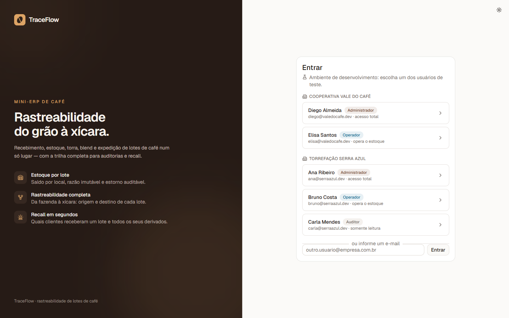

_Tela de entrada no ambiente de demonstração. Cada cartão é um usuário de teste com seu perfil (Administrador, Operador ou Auditor). No ambiente oficial esta lista não existe: entra-se com e-mail e senha._

**Sessão expirada.** Por segurança, a sessão expira depois de um tempo. Se isso acontecer, o sistema mostra "Sua sessão expirou", leva você para a entrada e, depois do login, **devolve você para a mesma página** em que estava.

**Para sair:** clique no seu nome no canto superior direito e escolha **Sair**.

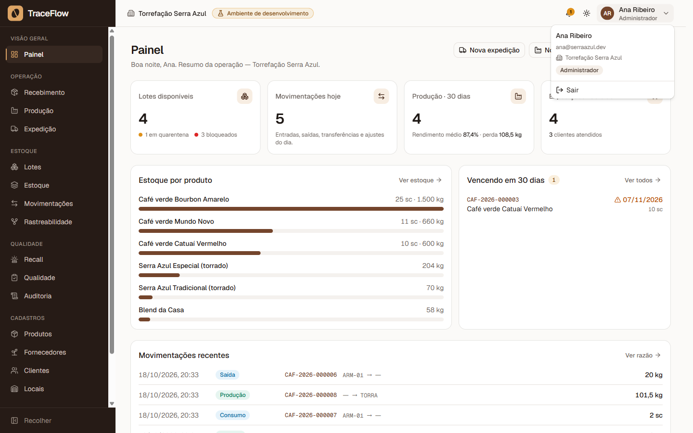

_Menu do usuário: mostra quem está conectado, o perfil e a empresa. A opção **Sair** encerra a sessão._

### 3.2 Conhecendo a tela principal

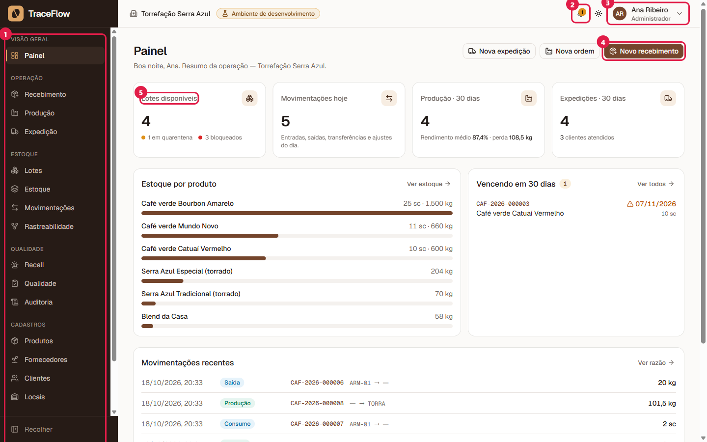

_Partes principais da tela. Os destaques em vermelho foram adicionados para este manual._

1. **Menu lateral** — organizado em seções: Visão geral, Operação, Estoque, Qualidade, Cadastros e Gestão. Os itens mudam conforme o seu perfil (por exemplo, **Auditoria** só aparece para administradores e auditores). O botão **Recolher**, no rodapé do menu, deixa só os ícones.
2. **Sino de validade** — mostra quantos lotes com saldo vencem nos próximos 30 dias. Fica vermelho se já houver lote vencido. Clicar leva à lista desses lotes.
3. **Menu do usuário** — nome, perfil, empresa e a opção **Sair**. Ao lado fica o botão do **tema** (claro, escuro ou o do sistema).
4. **Ações rápidas** — atalhos para **Novo recebimento**, **Nova ordem** e **Nova expedição** (aparecem só para quem pode operar o estoque).
5. **Cartões de indicadores** — clicáveis; levam à lista correspondente já filtrada.

No topo de cada página há uma **trilha** (ex.: _Estoque › Lotes › CAF-2026-000004_) que mostra onde você está e permite voltar com um clique. O nome da **empresa** aparece sempre no cabeçalho: cada empresa só enxerga os próprios dados.

### 3.3 Painel

**Como acessar:** menu **Painel** (é a primeira tela após o login).

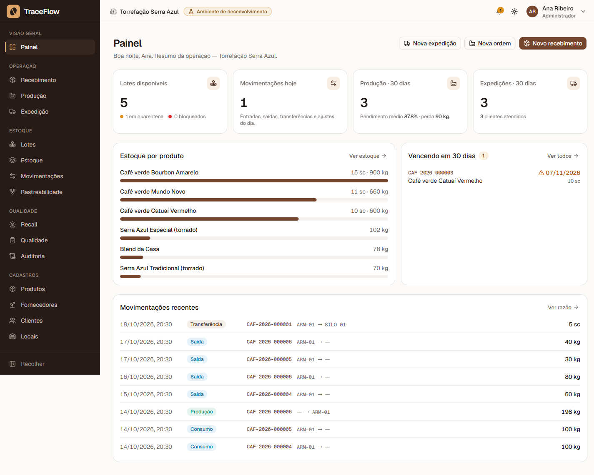

_O Painel reúne o resumo da operação._

| Bloco                      | O que mostra                                                                                 |
| -------------------------- | -------------------------------------------------------------------------------------------- |
| **Lotes disponíveis**      | Quantos lotes podem ser movimentados, quantos estão em quarentena e quantos estão bloqueados |
| **Movimentações hoje**     | Entradas, saídas, transferências e ajustes do dia                                            |
| **Produção · 30 dias**     | Número de ordens, rendimento médio e perda total em kg                                       |
| **Expedições · 30 dias**   | Número de expedições e de clientes atendidos                                                 |
| **Estoque por produto**    | Barras proporcionais ao peso em kg (sacas convertidas: 1 saca = 60 kg)                       |
| **Vencendo em 30 dias**    | Lotes com saldo perto da validade (data em vermelho/âmbar)                                   |
| **Movimentações recentes** | As últimas operações; **Ver razão** abre a lista completa                                    |

**Dica:** para o perfil Auditor, as ações rápidas mudam para **Ver estoque** e **Rastrear lote**.

### 3.4 Cadastros: produtos, fornecedores, clientes e locais

Antes de operar, é preciso cadastrar o que o sistema vai usar. As quatro telas de cadastro funcionam do mesmo jeito.

**Como acessar:** menu **Cadastros** › **Produtos**, **Fornecedores**, **Clientes** ou **Locais**.

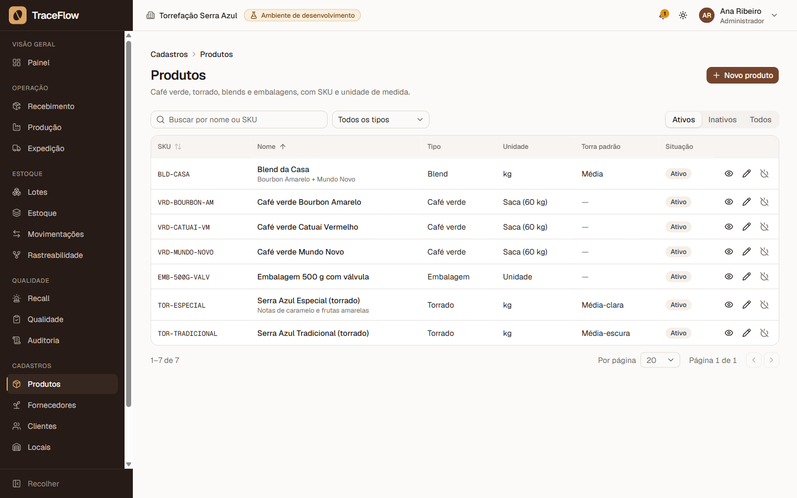

_Lista de produtos. No topo: busca, filtro por tipo e as abas **Ativos / Inativos / Todos**. Em cada linha: ver detalhes (olho), editar (lápis) e desativar._

**O que cada cadastro guarda:**

| Cadastro         | Principais campos                                                                                                                          | Para que serve                                                                      |
| ---------------- | ------------------------------------------------------------------------------------------------------------------------------------------ | ----------------------------------------------------------------------------------- |
| **Produtos**     | SKU (código interno único), nome, tipo (café verde, torrado, blend, embalagem), unidade (kg, saca de 60 kg, unidade), grau de torra padrão | Define o que entra, o que é produzido e o que é vendido                             |
| **Fornecedores** | Nome, tipo (produtor, fazenda, cooperativa, trader), CPF/CNPJ, fazenda, região, cidade/UF, altitude, variedades, contato                   | Origem do café; aparece na rastreabilidade e (sem dados pessoais) na página pública |
| **Clientes**     | Nome, CPF/CNPJ, e-mail, telefone, cidade/UF                                                                                                | Destino das expedições; base da lista de contatos do recall                         |
| **Locais**       | Código, nome, tipo (armazém, silo, torrefação, expedição, **quarentena**)                                                                  | Onde os lotes ficam guardados                                                       |

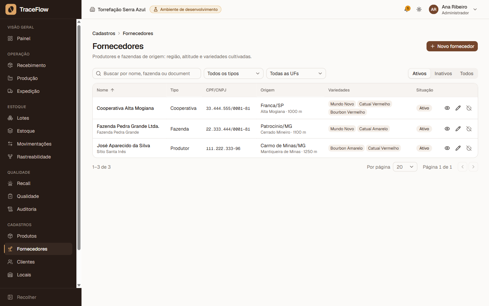

_Fornecedores: CPF e CNPJ aparecem formatados e são validados (dígitos verificadores) ao salvar._

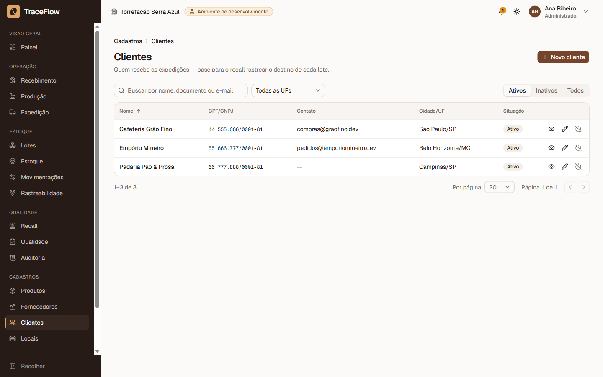

_Clientes: o e-mail e o telefone cadastrados aqui são os que aparecerão na lista de contatos de um recall. Mantenha-os atualizados._

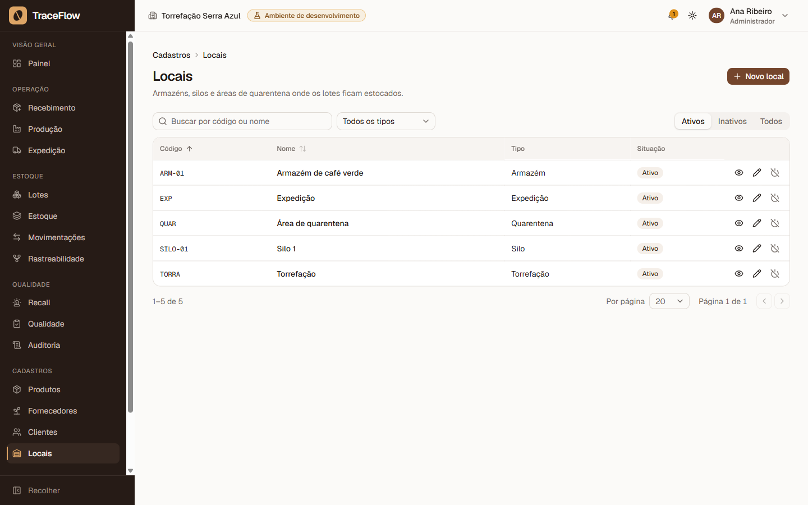

_Locais: crie pelo menos um local do tipo **Quarentena**. Lotes recebidos ou produzidos num local de quarentena já nascem em quarentena._

**Como cadastrar um item (exemplo: produto):**

1. Na tela **Produtos**, clique em **Novo produto** (canto superior direito).
2. Preencha os campos. Os marcados com **\*** são obrigatórios.
3. Clique em **Salvar**. Uma mensagem verde confirma o cadastro e o item aparece na lista.

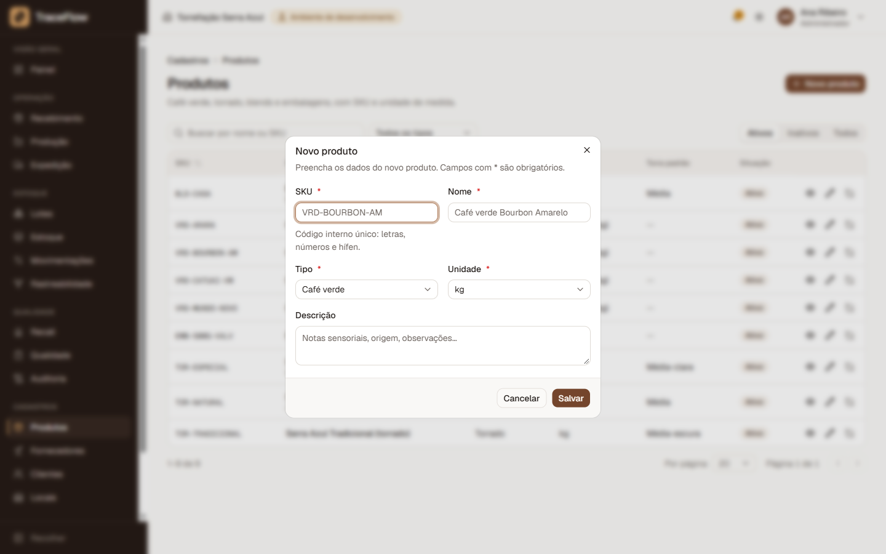

_Formulário de novo produto. O SKU aceita letras, números e hífen e não pode se repetir na sua empresa._

**Como editar:** clique no **lápis** da linha, altere e salve.

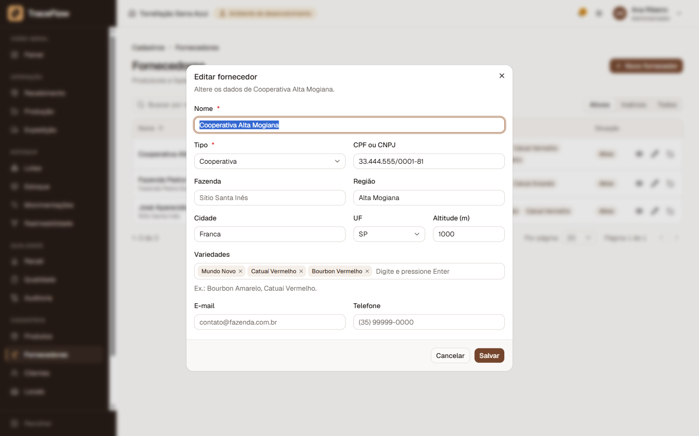

_Edição de fornecedor. Em **Variedades**, digite o nome e tecle Enter (ou vírgula) para adicionar; Backspace remove a última._

**Como desativar:** clique no ícone de desativar e confirme. Não existe exclusão: o item desativado some das opções de novos registros, mas continua no histórico. Para reativar, mude a aba para **Inativos** e use **Reativar**. (Desativar e reativar: só administrador.)

**Busca, filtros e páginas:** a busca procura enquanto você digita. Filtros, ordenação e página ficam guardados no endereço da página — você pode **salvar nos favoritos ou enviar o link** para um colega e ele verá a mesma lista (desde que seja da mesma empresa).

> **Cadastro em massa:** para carregar muitos itens de uma vez, use a [Importação por planilha](#317-importação-de-cadastros-por-planilha).

### 3.5 Recebimento de café

O recebimento é o ponto de partida da rastreabilidade: cada recebimento cria **um lote novo**.

**Quem pode:** Administrador e Operador.
**Como acessar:** menu **Operação › Recebimento**, ou o botão **Novo recebimento** no Painel ou na tela de Lotes.

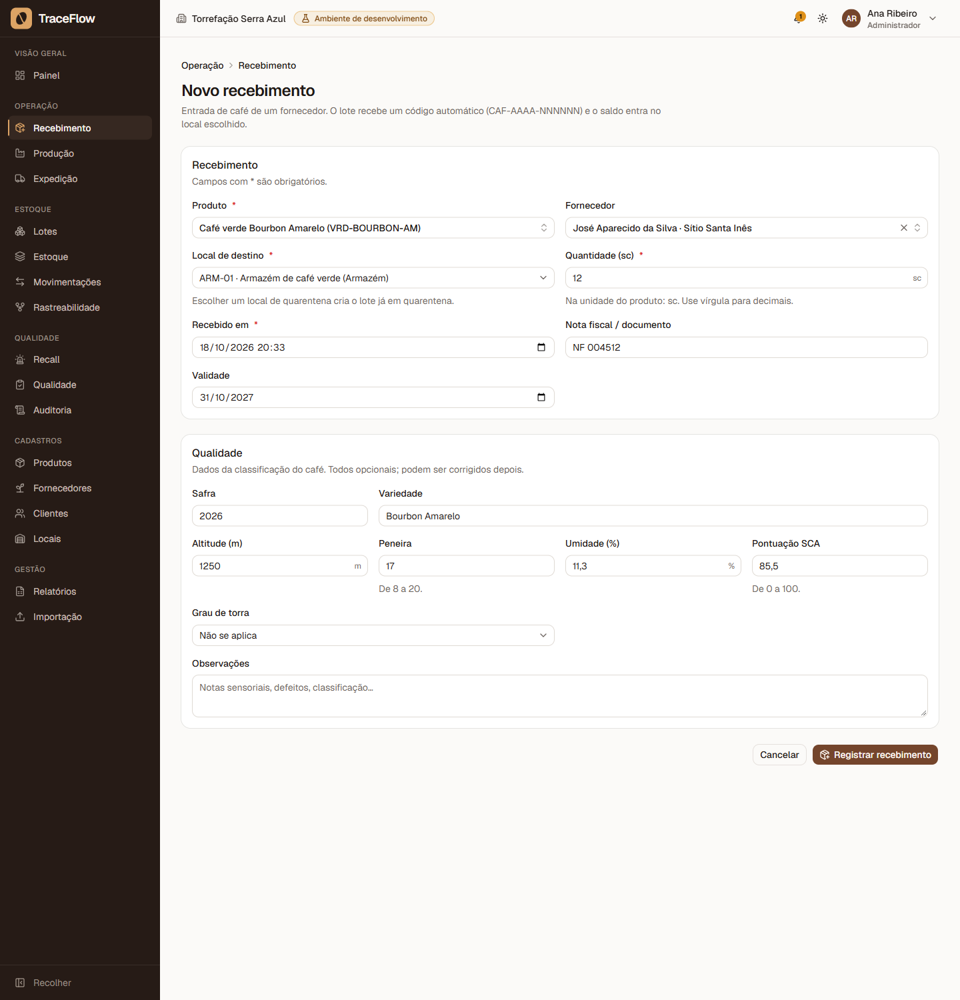

_Formulário de recebimento preenchido. À esquerda, os dados da entrada; abaixo, os dados de qualidade (todos opcionais)._

**Passo a passo:**

1. **Produto\*** — comece a digitar o nome ou o SKU e escolha na lista. A unidade do produto (kg, sc ou un) aparece no campo de quantidade.
2. **Fornecedor** — opcional, mas recomendado: é ele que liga o lote à fazenda de origem.
3. **Local de destino\*** — onde o café será guardado. Se escolher um local de **quarentena**, o lote nasce em quarentena.
4. **Quantidade\*** — na unidade do produto. Aceita vírgula (ex.: `12,5`).
5. **Recebido em\*** — data e hora (já vem preenchido com o momento atual).
6. **Nota fiscal / documento** e **Validade** — opcionais.
7. **Qualidade** — safra, variedade, altitude, peneira (8 a 20), umidade (%), pontuação SCA (0 a 100), grau de torra e observações. Podem ser corrigidos depois.
8. Clique em **Registrar recebimento**.

**Resultado:** aparece a mensagem _"Lote CAF-… recebido"_ e você é levado ao detalhe do novo lote.

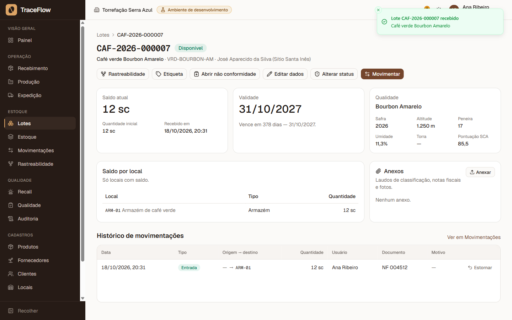

_Mensagem de sucesso e o detalhe do lote recém-recebido: saldo, validade (com dias restantes), qualidade e a primeira movimentação (Entrada)._

**Cuidados:**

- Se você tentar sair da página com o formulário preenchido, o sistema pergunta se quer descartar as alterações.
- Se a internet cair no meio do envio, pode clicar de novo em **Registrar**: o sistema reconhece a repetição e **não cria o lote em dobro**.

### 3.6 Lotes

**Como acessar:** menu **Estoque › Lotes**.

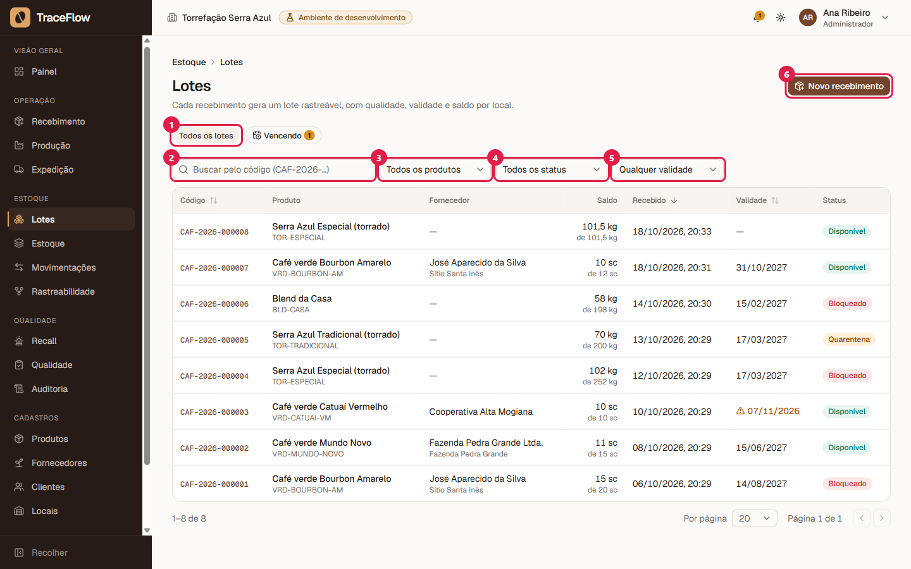

_Lista de lotes. Destaques adicionados para este manual._

1. **Todos os lotes / Vencendo** — alterna entre a lista completa e a visão de lotes com saldo perto de vencer (incluindo vencidos, os mais urgentes primeiro).
2. **Busca pelo código** — digite o código inteiro ou parte dele (ex.: `000004`).
3. **Produto** — filtra por produto.
4. **Status** — Disponível, Quarentena, Bloqueado ou Consumido.
5. **Validade** — lotes que vencem em 7, 15, 30, 60 ou 90 dias.
6. **Novo recebimento** — atalho para registrar uma entrada.

Na tabela, cada linha mostra: código (clique para abrir), produto, fornecedor/fazenda, saldo atual e quantidade inicial, data de recebimento, validade e status. **Validade vencida aparece em vermelho; vencendo em até 30 dias, em âmbar.** Lotes consumidos (saldo zerado) aparecem esmaecidos.

**Significado dos status:**

| Status         | O que significa                                      | O que é permitido                                                      |
| -------------- | ---------------------------------------------------- | ---------------------------------------------------------------------- |
| **Disponível** | Lote liberado                                        | Todas as operações                                                     |
| **Quarentena** | Aguardando análise (ex.: não conformidade aberta)    | Só pode ser movido para um local de quarentena                         |
| **Bloqueado**  | Suspenso (por recall ou decisão de um administrador) | Nenhuma saída, transferência ou consumo; estornos continuam permitidos |
| **Consumido**  | Saldo zerado                                         | Só consulta                                                            |

### 3.7 Detalhe do lote e suas ações

**Como acessar:** clique no código de um lote em qualquer lista.

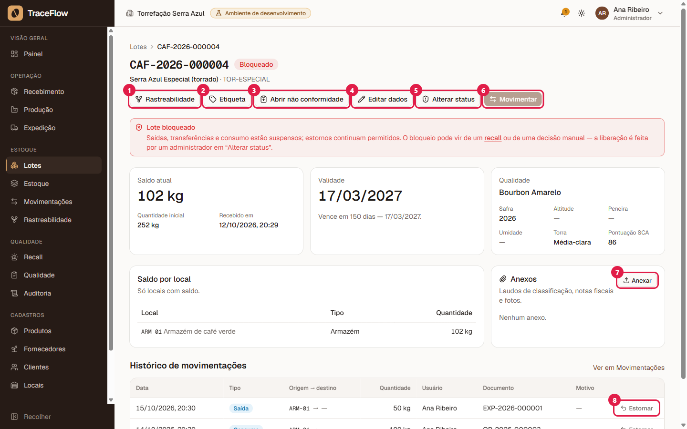

_Detalhe de um lote bloqueado por recall. Repare no aviso vermelho explicando o bloqueio e no botão **Movimentar** desativado. Destaques adicionados para este manual._

| #   | Ação                       | Quem pode                                                 | O que faz                                                                                                 |
| --- | -------------------------- | --------------------------------------------------------- | --------------------------------------------------------------------------------------------------------- |
| 1   | **Rastreabilidade**        | Todos                                                     | Abre a árvore de origem e destino deste lote                                                              |
| 2   | **Etiqueta**               | Todos                                                     | Gera o PDF da etiqueta com QR code (veja [3.12](#312-etiqueta-com-qr-code-e-página-pública))              |
| 3   | **Abrir não conformidade** | Administrador e Operador                                  | Registra um problema de qualidade e coloca o lote em quarentena                                           |
| 4   | **Editar dados**           | Administrador e Operador                                  | Corrige validade e dados de qualidade                                                                     |
| 5   | **Alterar status**         | Administrador (todos os status); Operador (só quarentena) | Muda o status com motivo obrigatório                                                                      |
| 6   | **Movimentar**             | Administrador e Operador                                  | Saída, transferência, consumo ou ajuste                                                                   |
| 7   | **Anexar**                 | Administrador e Operador                                  | Envia laudos, notas e fotos (PDF, JPEG, PNG ou WebP, até 10 MB). Para abrir um anexo, clique no nome dele |
| 8   | **Estornar**               | Administrador                                             | Desfaz uma movimentação criando uma movimentação inversa, com motivo                                      |

Os cartões mostram **saldo atual** e quantidade inicial, **validade** (com dias restantes), **qualidade**, **saldo por local** e **anexos**. Abaixo, o **histórico de movimentações** do lote; o link **Ver em Movimentações** abre o razão já filtrado.

**Movimentar um lote — passo a passo:**

1. No detalhe do lote, clique em **Movimentar**.
2. Escolha o **Tipo**:
   - **Saída** — venda avulsa ou baixa do estoque.
   - **Transferência** — de um local para outro.
   - **Consumo** — uso interno.
   - **Ajuste** (só administrador) — perda ou sobra de inventário; motivo obrigatório.
3. Escolha a **Origem** (só aparecem locais com saldo, já com o disponível) e, se for transferência, o **Destino**.
4. Informe a **Quantidade** e, se quiser, **Documento** e **Motivo**.
5. Clique no botão de confirmação (ex.: **Registrar transferência**).

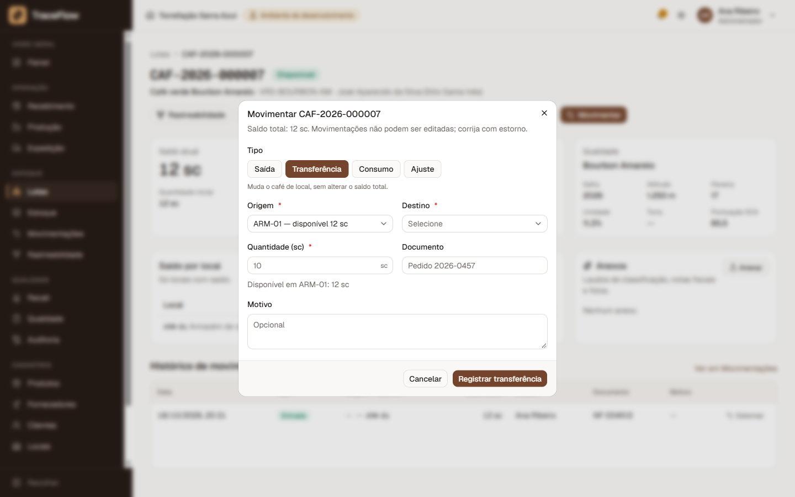

_Diálogo de movimentação. O texto do topo lembra: movimentações não podem ser editadas; corrija com estorno._

**Corrigindo um erro (estorno):** movimentações **nunca são apagadas nem editadas**. Se algo foi lançado errado, um administrador clica em **Estornar** na linha do histórico, informa o motivo e o sistema cria uma movimentação inversa. A linha original fica marcada como _Estornada_. Isso garante um histórico confiável para auditorias.

### 3.8 Estoque e movimentações

**Estoque** (menu **Estoque › Estoque**) mostra uma linha para cada combinação lote × local, com produto, local, quantidade, validade e status. Filtre por código, produto, local ou status.

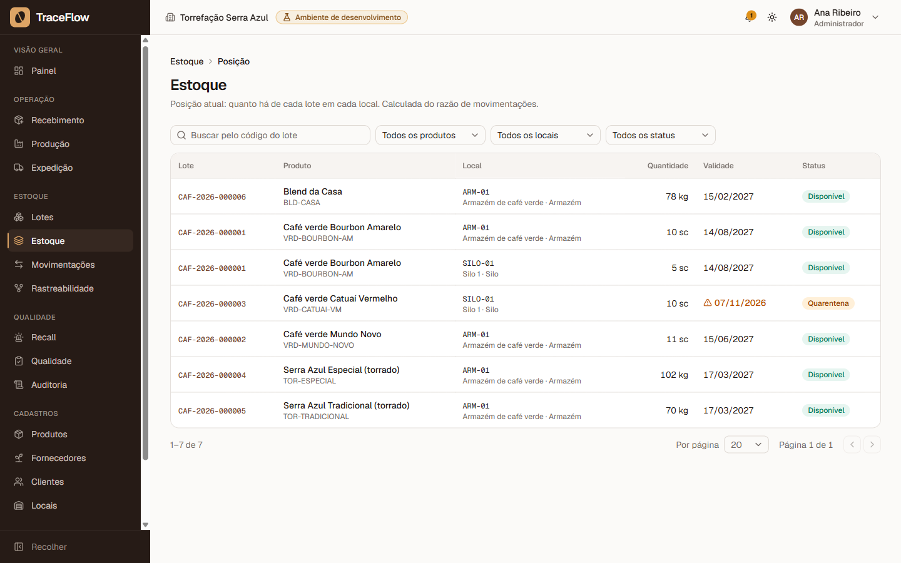

_Posição de estoque: onde está cada lote e quanto há em cada local._

**Movimentações** (menu **Estoque › Movimentações**) é o razão completo, do mais recente para o mais antigo: data, tipo, lote, origem → destino, quantidade, usuário, documento e motivo. Filtre por tipo, local, período ou lote.

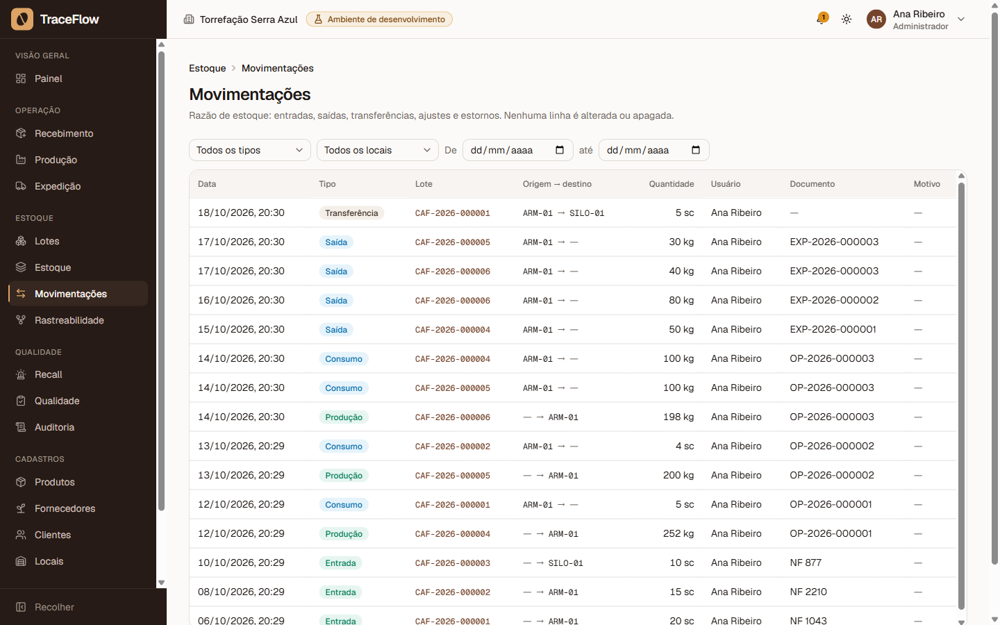

_Razão de movimentações. Cada linha tem o usuário que fez a operação e o documento (NF, número da OP ou da expedição)._

| Tipo          | Significado                                        |
| ------------- | -------------------------------------------------- |
| Entrada       | Recebimento de fornecedor                          |
| Saída         | Venda/expedição                                    |
| Transferência | Mudança de local                                   |
| Consumo       | Uso do lote como insumo de produção ou uso interno |
| Produção      | Entrada do lote gerado por uma ordem de produção   |
| Ajuste        | Correção de inventário (perda ou sobra)            |
| Estorno       | Movimentação inversa que anula outra               |

### 3.9 Produção (beneficiamento, torra, blend e embalagem)

Uma **ordem de produção (OP)** consome um ou mais lotes de insumo e gera **um lote novo**, automaticamente ligado aos insumos. É isso que permite rastrear um blend até as fazendas de origem.

**Quem pode registrar:** Administrador e Operador.
**Como acessar:** menu **Operação › Produção** e botão **Nova ordem**.

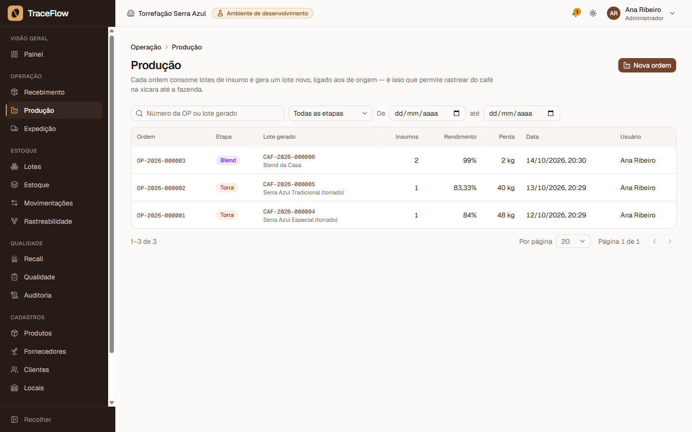

_Lista de ordens de produção. Rendimento de torra fora da faixa típica (75% a 90%) aparece em âmbar._

**Passo a passo:**

1. **Etapa** — escolha o cartão:

   | Etapa          | Insumos aceitos             | Produto gerado   |
   | -------------- | --------------------------- | ---------------- |
   | Beneficiamento | Café verde                  | Café verde       |
   | Torra          | Café verde                  | Torrado          |
   | Blend          | Torrado e blend             | Blend            |
   | Embalagem      | Torrado, blend e embalagens | Torrado ou blend |

2. **Insumos** — em cada linha, escolha o lote (só aparecem lotes disponíveis e compatíveis com a etapa, com o local e o saldo) e a quantidade. Use **Adicionar insumo** para incluir mais (até 20).
3. **Saída** — produto gerado, local, quantidade produzida e data. Opcionalmente: validade, pontuação SCA, grau de torra e observações. Safra e variedade são herdadas automaticamente quando todos os insumos coincidem.
4. Confira o cartão **Balanço de massa**, à direita: entrada e saída em kg, rendimento e perda estimados.
5. Clique em **Registrar ordem**.

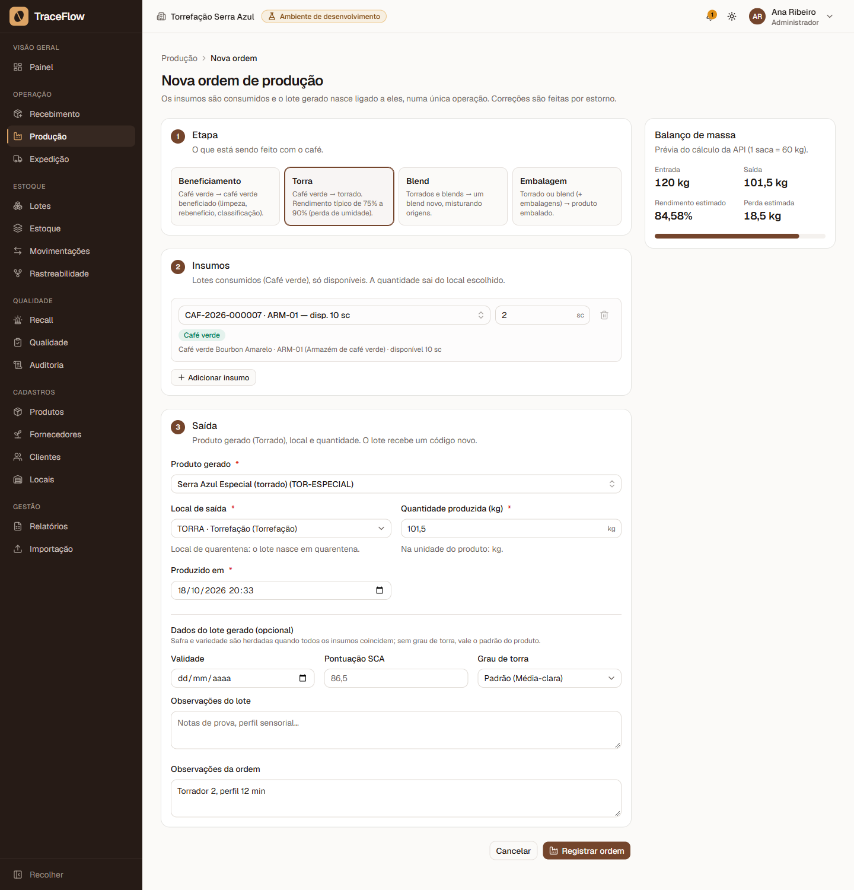

_Exemplo real: 2 sacas (120 kg) de café verde torradas em 101,5 kg de torrado — rendimento de 84,58% e perda de 18,5 kg, calculados ao vivo._

**Resultado:** mensagem _"OP-… concluída — lote CAF-… gerado"_ e o detalhe da ordem.

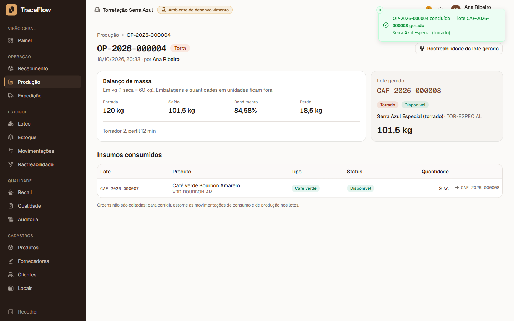

_Detalhe da ordem: balanço (entrada, saída, rendimento, perda), lote gerado e insumos consumidos, com atalho para a rastreabilidade do lote gerado._

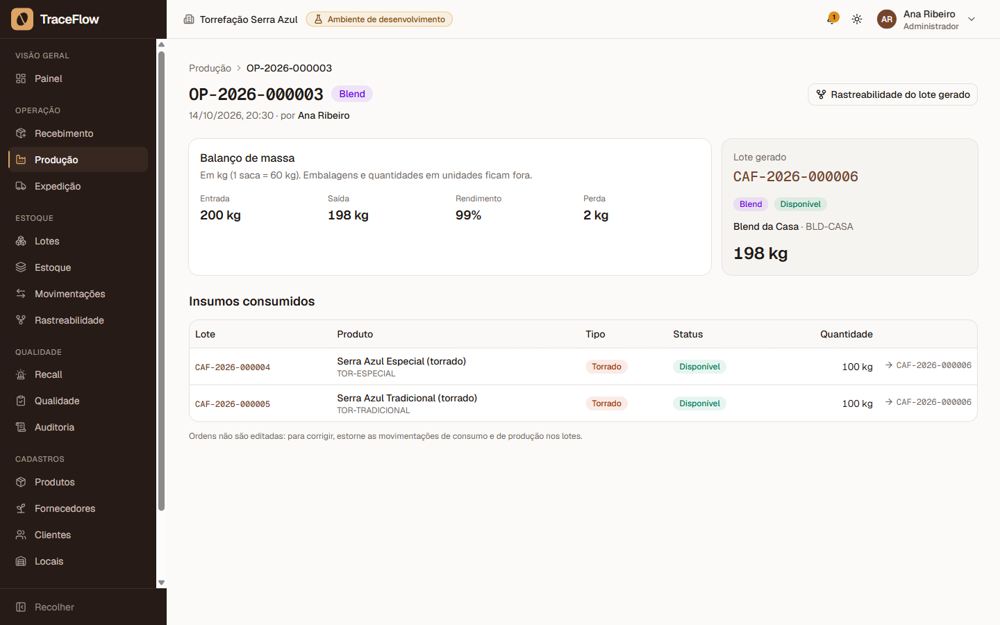

_Exemplo de blend: dois lotes torrados (100 kg de cada) viraram 198 kg do Blend da Casa._

**Regras importantes:** a quantidade produzida **não pode ser maior** que a entrada (em kg); quantidades em unidades (embalagens) ficam fora da conta de massa. Para corrigir uma OP, um administrador estorna as movimentações correspondentes no histórico dos lotes.

### 3.10 Expedição para clientes

A expedição registra o envio de café para um cliente. Cada item é uma saída de estoque; **ou tudo é gravado, ou nada é** — se um item falhar (por exemplo, saldo insuficiente), nenhum é lançado.

**Quem pode registrar:** Administrador e Operador.
**Como acessar:** menu **Operação › Expedição** e botão **Nova expedição**.

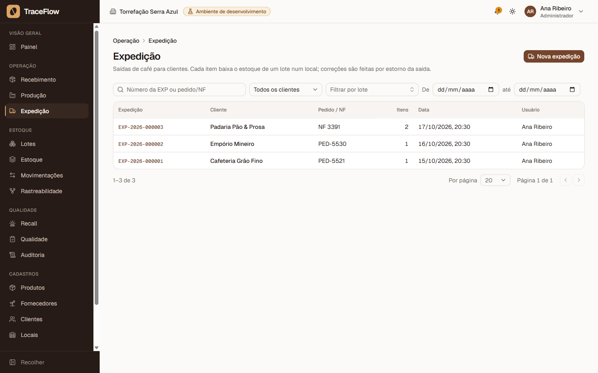

_Lista de expedições, com busca por número ou pedido/NF e filtros por cliente, lote e período._

**Passo a passo:**

1. **Cliente\*** — digite e escolha (só clientes ativos).
2. **Pedido / NF** e **Expedido em** (data e hora).
3. **Itens** — para cada item, escolha o lote/local e a quantidade (até 50 itens). **Adicionar item** inclui outra linha.
4. **Observações** — opcional.
5. Clique em **Registrar expedição**.

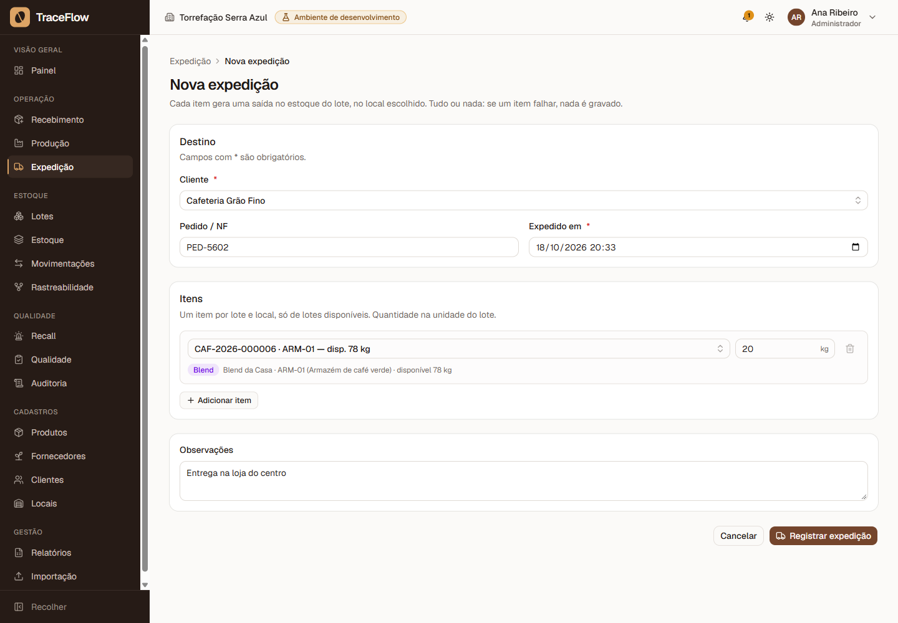

_Nova expedição preenchida: 20 kg do Blend da Casa para a Cafeteria Grão Fino._

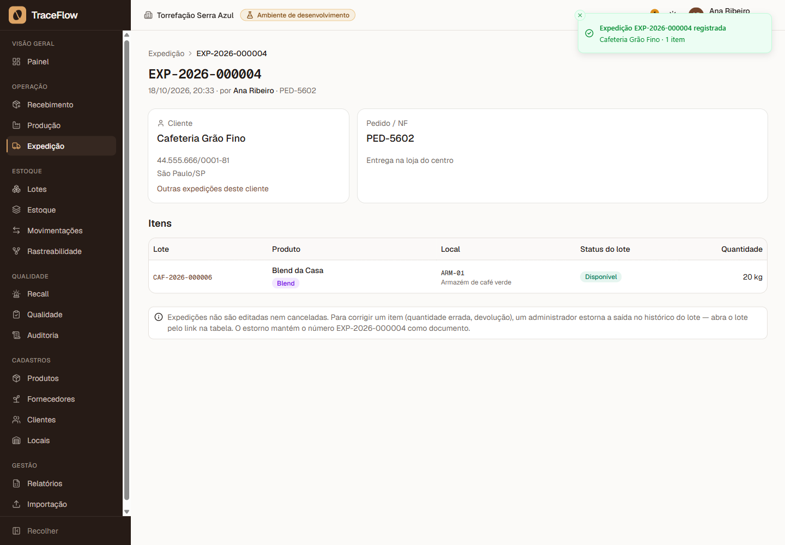

_Expedição registrada. O detalhe mostra o cliente, o pedido e os itens com link para cada lote. Correção: estorno da saída do item no histórico do lote (feito por um administrador)._

### 3.11 Rastreabilidade

**Como acessar:** menu **Estoque › Rastreabilidade** (busca pelo código) ou o botão **Rastreabilidade** no detalhe de um lote.

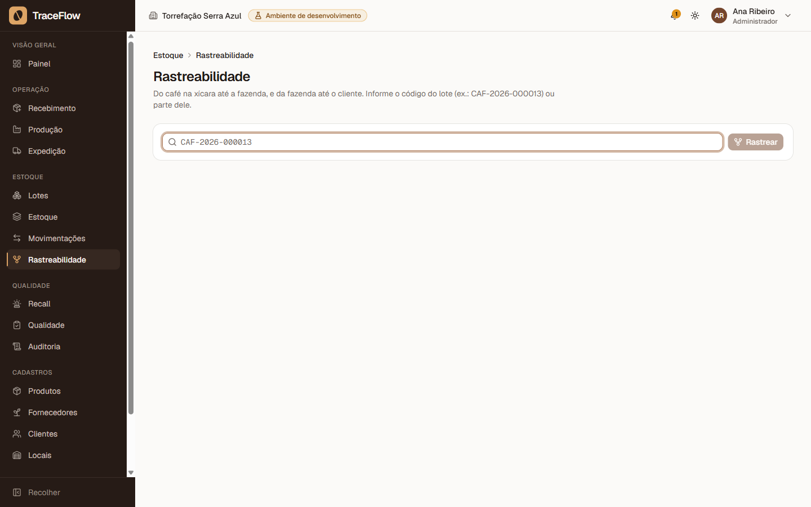

_Busca: digite o código completo para ir direto à árvore, ou parte dele para escolher entre até 10 lotes._

A tela tem duas abas:

**Para trás (origem)** — de onde veio o lote: lotes de insumo, ordens de produção e fazendas.

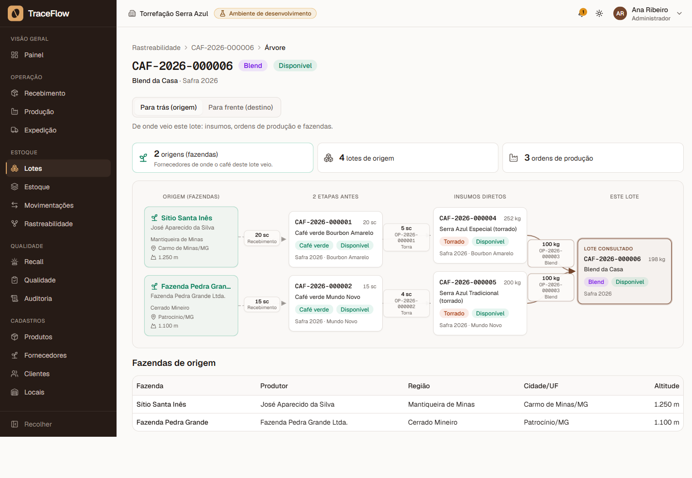

_Origem do lote de blend `CAF-2026-000006`: ele foi feito com dois torrados, que vieram de dois lotes verdes, de duas fazendas. Cada ligação mostra a quantidade e a ordem de produção._

**Para frente (destino)** — para onde foi o lote: derivados, expedições e **clientes afetados**.

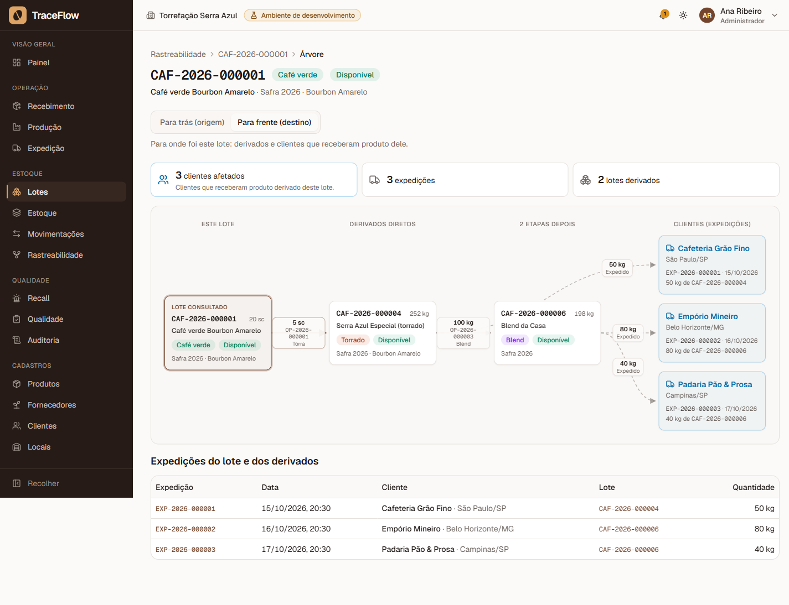

_Destino do lote verde `CAF-2026-000001`: ele virou um torrado e depois um blend, que chegaram a 3 clientes. É esta visão que responde "quem recebeu café deste lote?"._

Clique em qualquer cartão de lote para navegar até a rastreabilidade dele. Abaixo da árvore há uma tabela com as fazendas de origem ou as expedições. Se a cadeia for muito longa, um aviso **"Grafo truncado"** indica que nem todos os níveis foram exibidos.

### 3.12 Etiqueta com QR code e página pública

**Como acessar:** no detalhe do lote, botão **Etiqueta**.

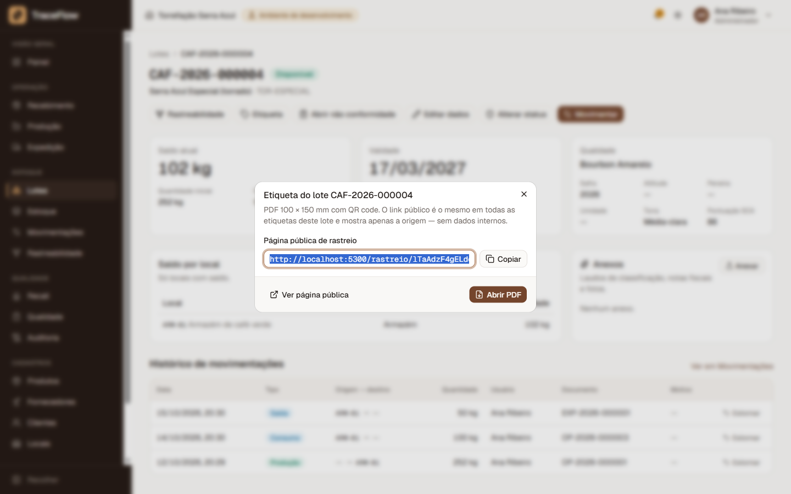

_Diálogo da etiqueta. O link público é o mesmo em todas as etiquetas deste lote._

- **Abrir PDF** — abre a etiqueta (100 × 150 mm) pronta para imprimir.
- **Copiar** — copia o link da página pública.
- **Ver página pública** — abre a página que o consumidor verá.

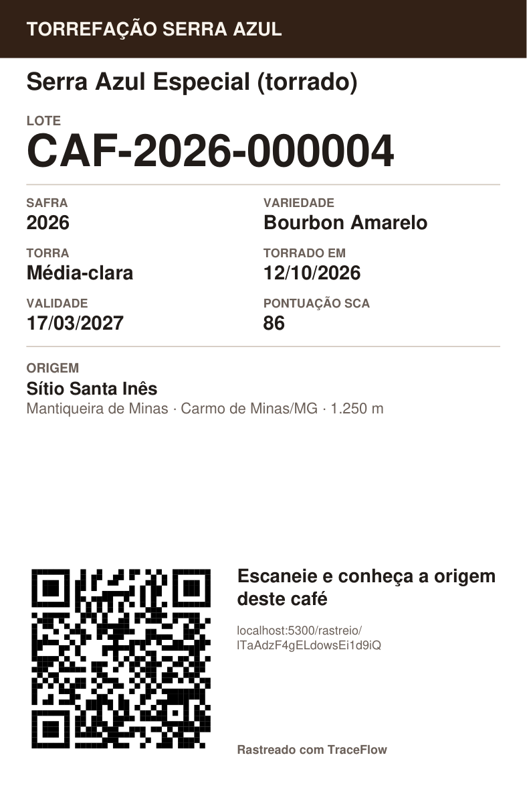

_Etiqueta gerada (a página do PDF). No ambiente oficial, o endereço abaixo do QR code será o do seu domínio._

**Página pública** — qualquer pessoa que ler o QR code vê, **sem login**, o produto, o lote, a torra, a safra, a variedade, a validade, a fazenda/região/altitude de origem e a linha do tempo "do grão à xícara".

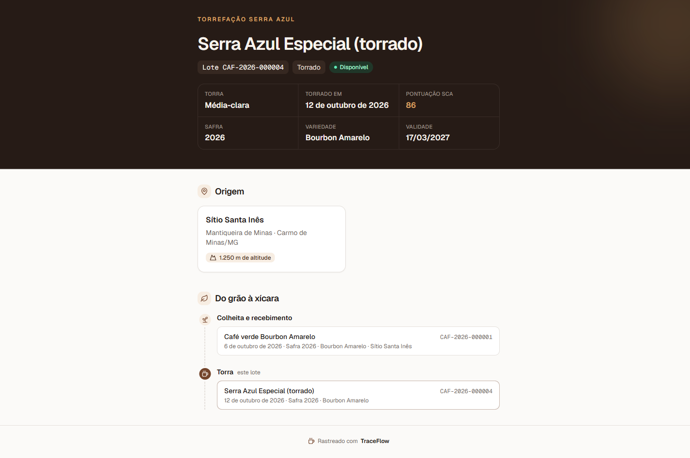

_Página pública de rastreio._

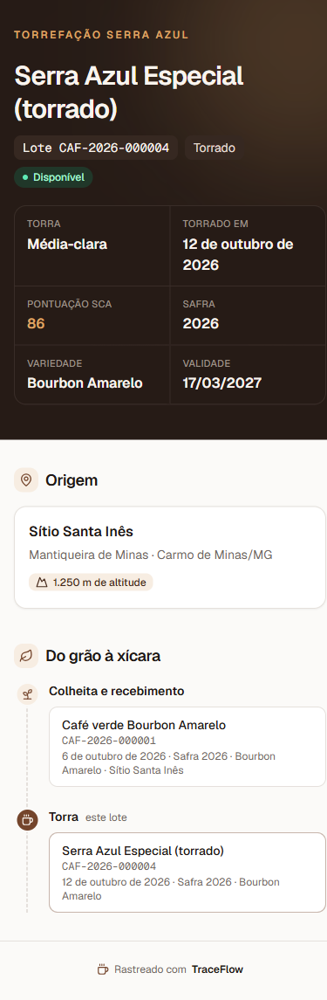

_A mesma página no celular, como o consumidor a verá ao ler o QR code._

**Privacidade:** a página pública **não mostra** nome pessoal de produtor (mostra o nome da fazenda), documentos, quantidades em estoque nem clientes.

### 3.13 Qualidade: não conformidades

Uma **não conformidade (NC)** registra um problema de qualidade num lote (umidade, defeitos, contaminação, pragas, embalagem ou outro). Ao abrir a NC, um lote disponível vai para **quarentena** e fica retido até um administrador decidir.

**Quem pode:** abrir — Administrador e Operador; liberar ou descartar — Administrador.
**Como acessar:** menu **Qualidade › Qualidade**, ou o botão **Abrir não conformidade** no detalhe do lote.

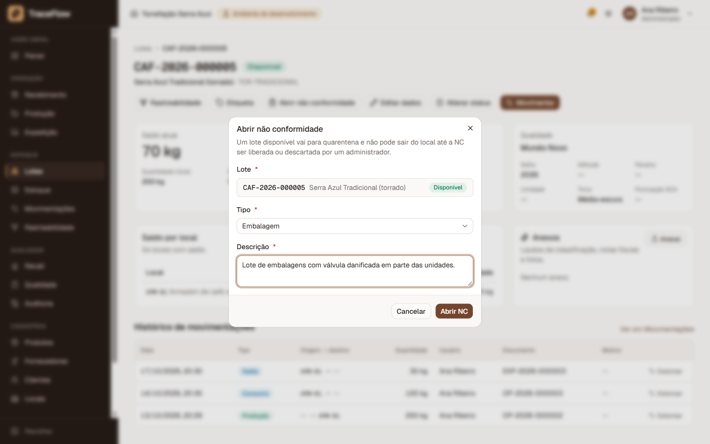

_Abrindo uma NC a partir do lote: escolha o tipo e descreva o problema._

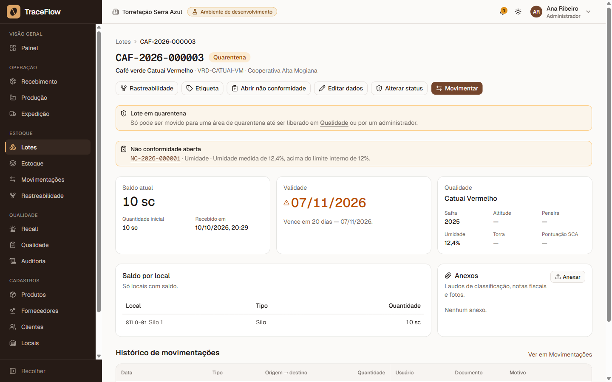

_Com a NC aberta, o lote mostra os avisos de **quarentena** e de **não conformidade aberta**, com link para ela._

**Decidir uma NC (administrador):**

1. Abra a NC (pela lista **Qualidade** ou pelo aviso no lote).
2. Escolha:
   - **Liberar** — o lote volta a Disponível. Justificativa obrigatória.
   - **Descartar** — dá baixa de **todo** o saldo do lote em todos os locais (o sistema mostra quanto será baixado e de onde antes de confirmar). Justificativa obrigatória.

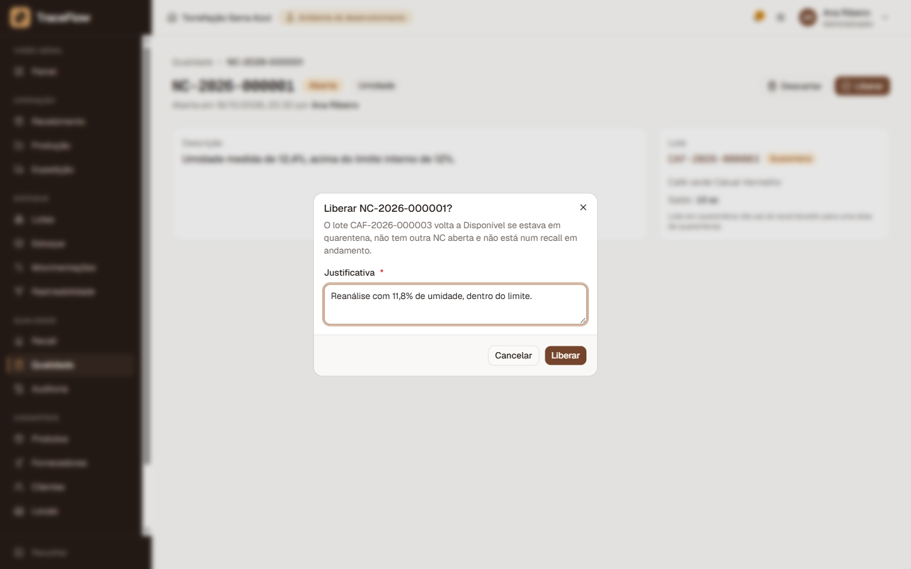

_Liberação de uma NC com a justificativa._

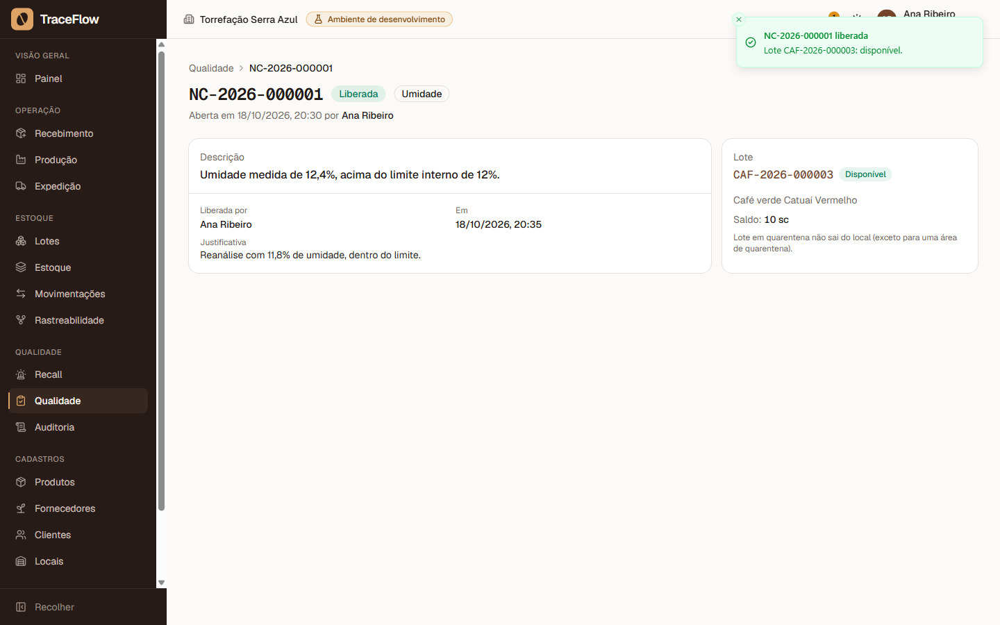

_Resultado: NC **Liberada**, com quem liberou, quando e por quê; o lote voltou a Disponível._

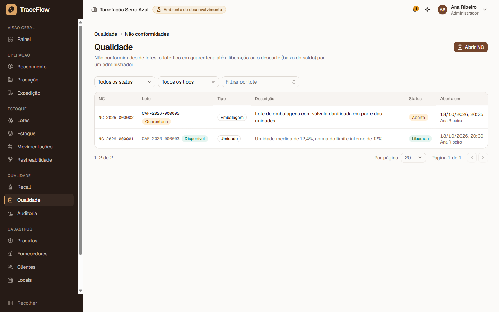

_Lista de NCs com filtros por status (Aberta, Liberada, Descartada), tipo e lote._

### 3.14 Recall (recolhimento)

O recall é usado quando um lote apresenta problema grave (ex.: laudo reprovado). O TraceFlow encontra **o lote e todos os derivados**, mostra **quais clientes receberam** e, ao executar, **bloqueia** esses lotes, gera um **relatório em PDF** e **avisa a equipe**.

**Quem pode:** simular — todos os perfis; executar, tentar de novo e encerrar — Administrador.
**Como acessar:** menu **Qualidade › Recall** e botão **Novo recall**.

**Passo 1 — Simular (não grava nada):**

1. Em **Lote de origem**, escolha o lote com problema.
2. Clique em **Simular impacto**.
3. Analise: lotes afetados (origem e derivados, com saldo), saldo a bloquear, quantidade já expedida, clientes a contatar (com as expedições) e fazendas de origem.

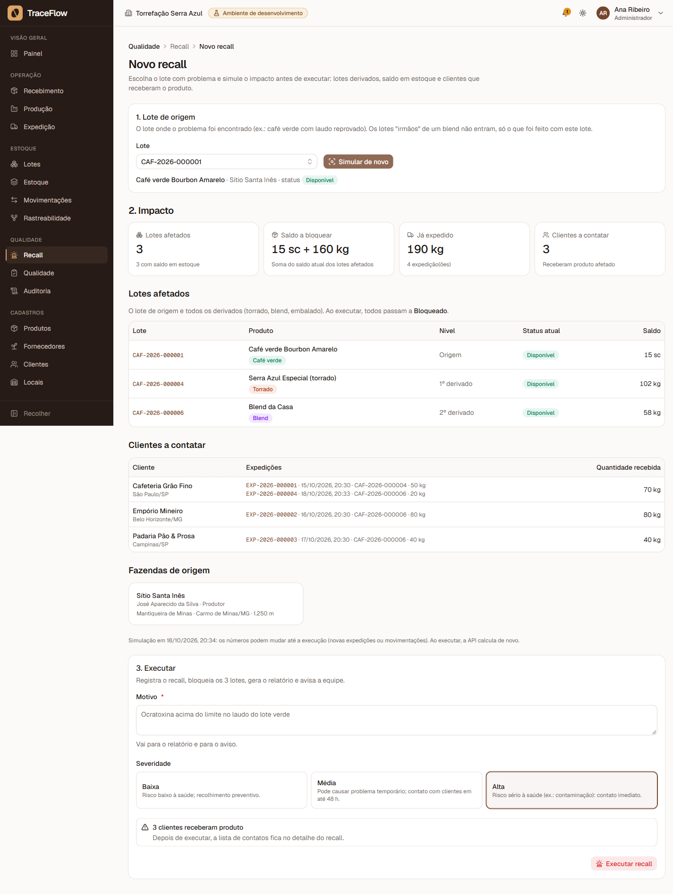

_Simulação do recall do lote verde `CAF-2026-000001`: 3 lotes afetados, 190 kg já expedidos para 3 clientes._

**Passo 2 — Executar (administrador):**

1. Preencha o **Motivo** (mínimo de 5 caracteres; vai para o relatório).
2. Escolha a **Severidade**: Baixa, Média ou Alta.
3. Clique em **Executar recall**.
4. Na confirmação, **digite o código do lote** para liberar o botão e confirme. Esta ação não pode ser desfeita.

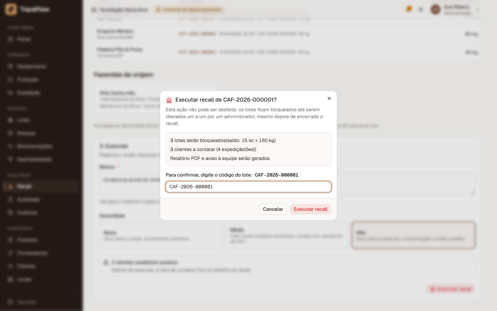

_Confirmação reforçada: o botão só é liberado depois de digitar o código do lote._

**Passo 3 — Acompanhar:**

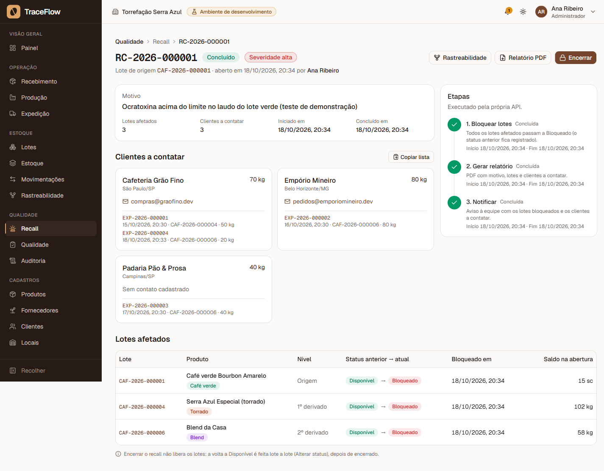

_Detalhe do recall: as três etapas (bloquear lotes, gerar relatório, notificar), os **clientes a contatar** com e-mail e expedições, e os lotes afetados com o status anterior e o atual._

- **Copiar lista** — copia os contatos dos clientes em texto pronto para colar num e-mail.
- **Relatório PDF** — abre o relatório oficial do recall.
- **Tentar de novo** — aparece se alguma etapa falhar.
- **Encerrar** — finaliza o recall (notas obrigatórias). **Encerrar não libera os lotes:** cada lote volta a Disponível individualmente, por um administrador, em **Alterar status**.

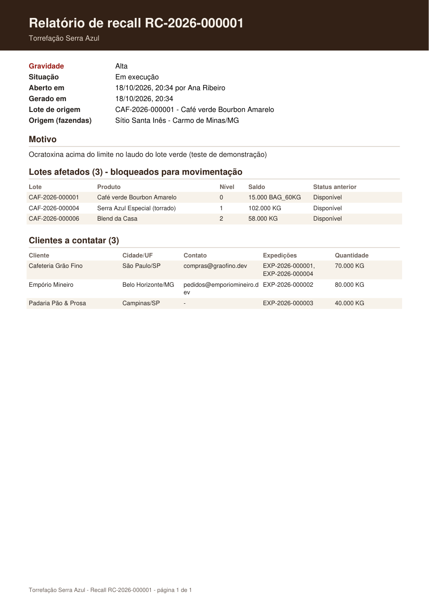

_Relatório do recall em PDF. **Atenção:** na versão atual, as quantidades do relatório aparecem com três casas decimais e a unidade em código (ex.: `15.000 BAG_60KG` significa 15 sacas; `70.000 KG` significa 70 kg). Use a tela do recall como referência dos números até essa correção (veja [Limitações](#6-limitações-conhecidas))._

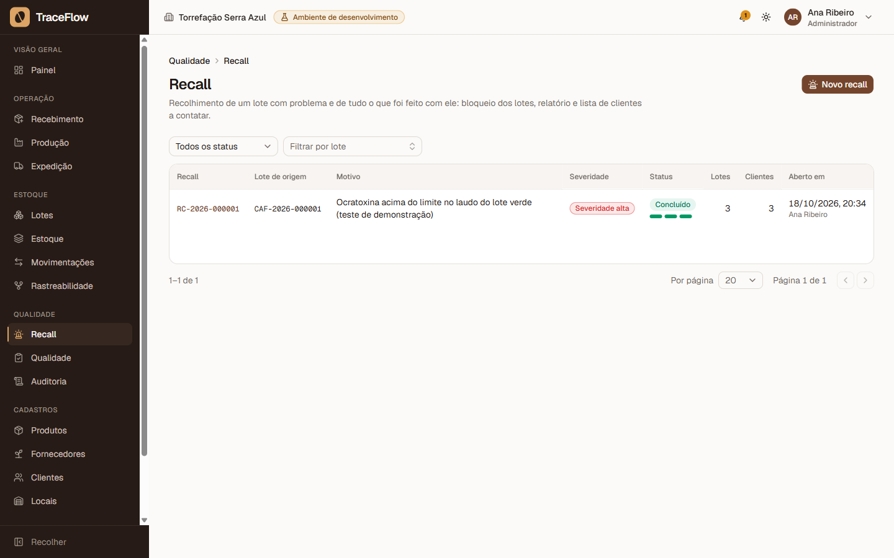

_Lista de recalls, com filtros por status e lote. Enquanto um recall está em execução, a lista se atualiza sozinha._

> **Importante:** o sistema **não envia** e-mails aos clientes. O aviso automático vai para a equipe responsável; o contato com os clientes é feito pela sua equipe, usando a lista do recall.

### 3.15 Auditoria

**Quem pode:** Administrador e Auditor. Para os demais, a tela mostra "Acesso restrito".
**Como acessar:** menu **Qualidade › Auditoria**.

Cada operação que altera dados gera uma entrada **imutável**: data, usuário, ação, registro afetado e o identificador da requisição. Clique numa linha para ver o **antes e depois** campo a campo, com as alterações destacadas.

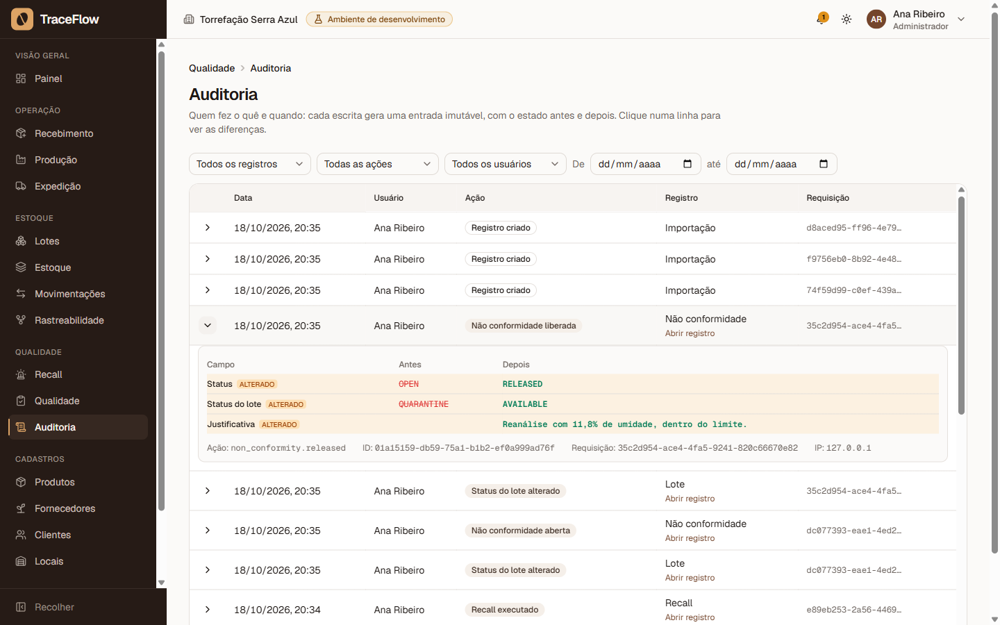

_Auditoria com o detalhe da liberação de uma NC: status de OPEN para RELEASED, lote de QUARANTINE para AVAILABLE e a justificativa._

Filtros: tipo de registro, ação, usuário e período. **Abrir registro** leva direto ao lote, recall, NC, ordem ou expedição.

### 3.16 Relatórios em planilha

**Quem pode:** todos os perfis.
**Como acessar:** menu **Gestão › Relatórios**.

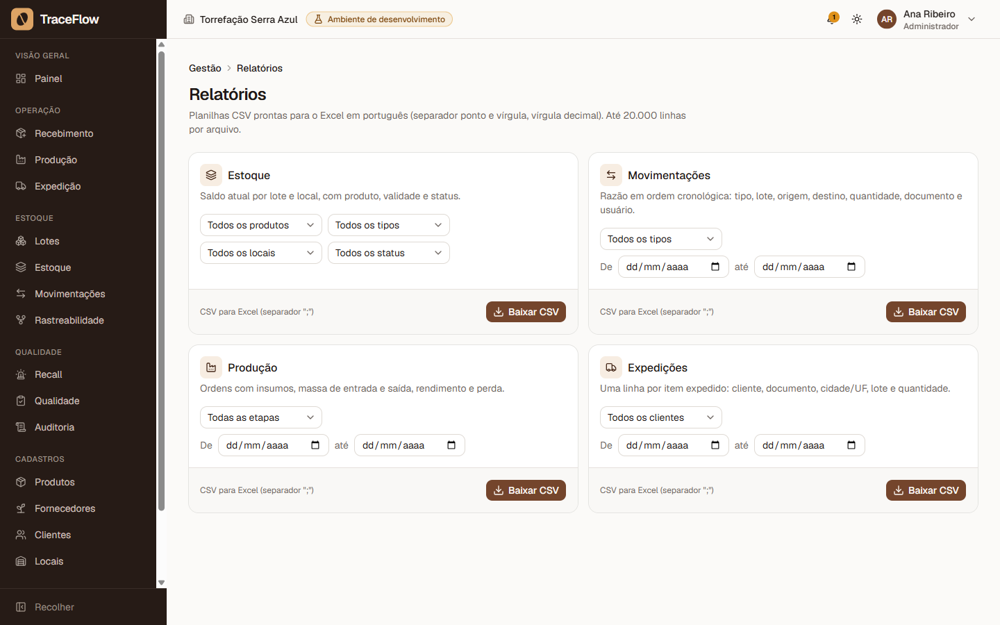

_Quatro relatórios, cada um com seus filtros._

1. Escolha o relatório (**Estoque**, **Movimentações**, **Produção** ou **Expedições**).
2. Ajuste os filtros (produto, tipo, local, status, cliente, período).
3. Clique em **Baixar CSV**. O arquivo abre direto no Excel em português (separador ponto e vírgula e vírgula decimal).

Limite de 20.000 linhas por arquivo; se o limite for atingido, o sistema avisa — use um período menor.

### 3.17 Importação de cadastros por planilha

**Quem pode:** Administrador.
**Como acessar:** menu **Gestão › Importação**.

**Passo a passo:**

1. **Cadastro** — escolha Produtos, Fornecedores, Clientes ou Locais. A tela mostra as colunas aceitas (obrigatórias com **\***).
2. Clique em **Baixar modelo** para obter a planilha-modelo já no formato certo. Preencha no Excel e salve como CSV.
3. **Arquivo** — escolha o arquivo (até 2 MB e 5.000 linhas). O sistema **valida sem gravar nada**.
4. **Resultado da validação** — mostra linhas, válidas e com erro, com uma tabela _linha × campo × problema_.
5. Corrija os erros na planilha e escolha o arquivo de novo. O botão **Importar** só é liberado quando não há nenhum erro, e grava tudo de uma vez.

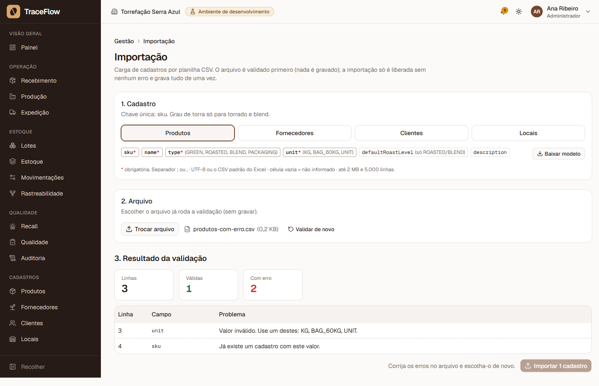

_Validação com erros: na linha 3 a unidade "SACA" não existe (use KG, BAG_60KG ou UNIT); na linha 4 o SKU já está cadastrado. A importação fica bloqueada._

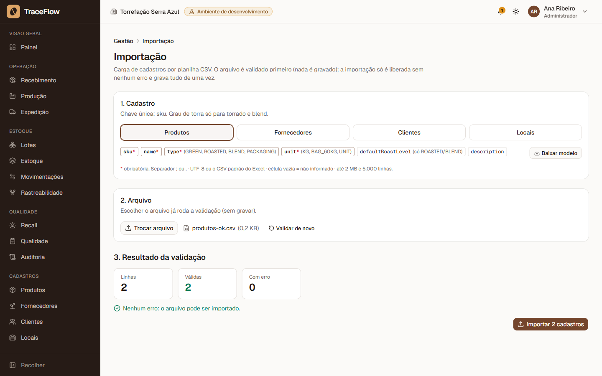

_Arquivo corrigido: nenhum erro, botão **Importar 2 cadastros** liberado._

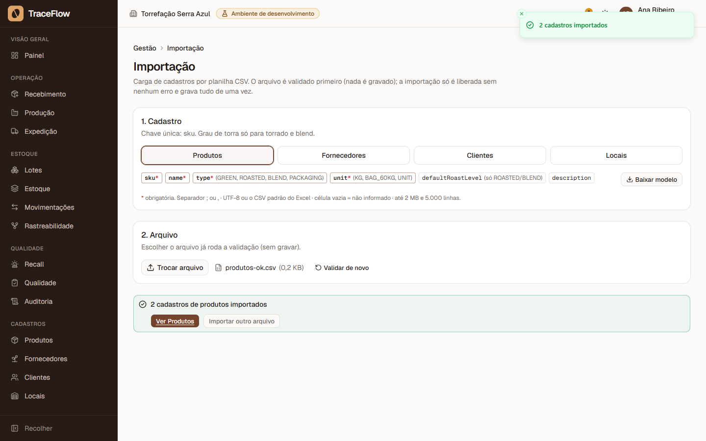

_Importação concluída, com link para o cadastro._

### 3.18 Perfis de acesso: o que cada um pode fazer

Cada usuário tem um perfil, definido pela equipe técnica ao criar o acesso.

| Ação                                                                 | Administrador |      Operador      | Auditor |
| -------------------------------------------------------------------- | :-----------: | :----------------: | :-----: |
| Consultar tudo (painel, lotes, estoque, rastreabilidade, relatórios) |      ✅       |         ✅         |   ✅    |
| Criar e editar cadastros                                             |      ✅       |         ✅         |    —    |
| Desativar e reativar cadastros                                       |      ✅       |         —          |    —    |
| Recebimento, movimentação, produção, expedição, anexos               |      ✅       |         ✅         |    —    |
| Ajuste de inventário e estorno                                       |      ✅       |         —          |    —    |
| Alterar status do lote                                               |  ✅ (todos)   | só para quarentena |    —    |
| Abrir não conformidade                                               |      ✅       |         ✅         |    —    |
| Liberar ou descartar não conformidade                                |      ✅       |         —          |    —    |
| Simular recall                                                       |      ✅       |         ✅         |   ✅    |
| Executar, retomar e encerrar recall                                  |      ✅       |         —          |    —    |
| Auditoria                                                            |      ✅       |         —          |   ✅    |
| Importação por planilha                                              |      ✅       |         —          |    —    |

O sistema esconde os botões que o perfil não pode usar. Ainda assim, a regra vale também "por trás da tela": mesmo que alguém tente burlar, o servidor recusa a operação.

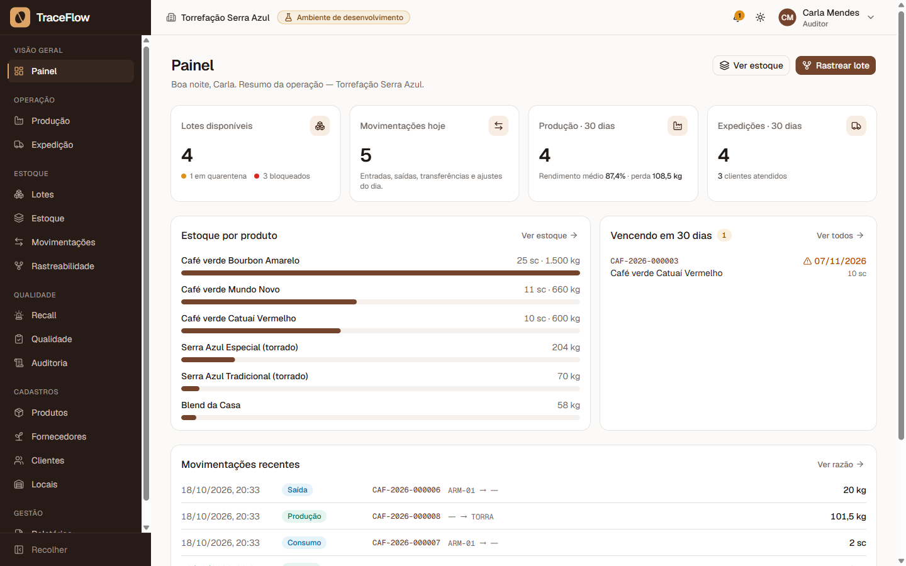

_Painel do **Auditor**: o menu não tem Recebimento e as ações rápidas são só de consulta._

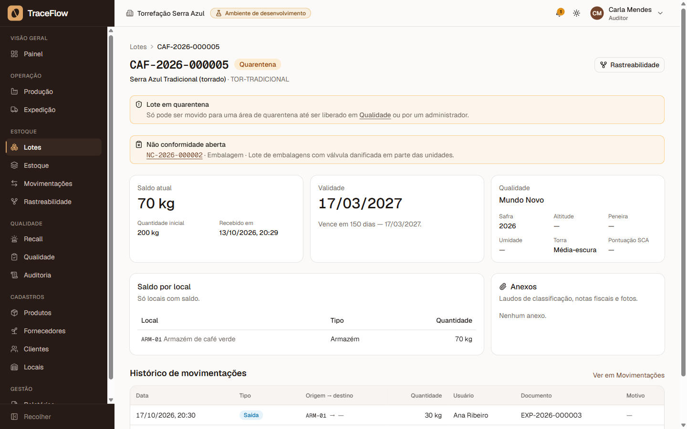

_Detalhe de lote para o **Auditor**: somente leitura (só o botão Rastreabilidade)._

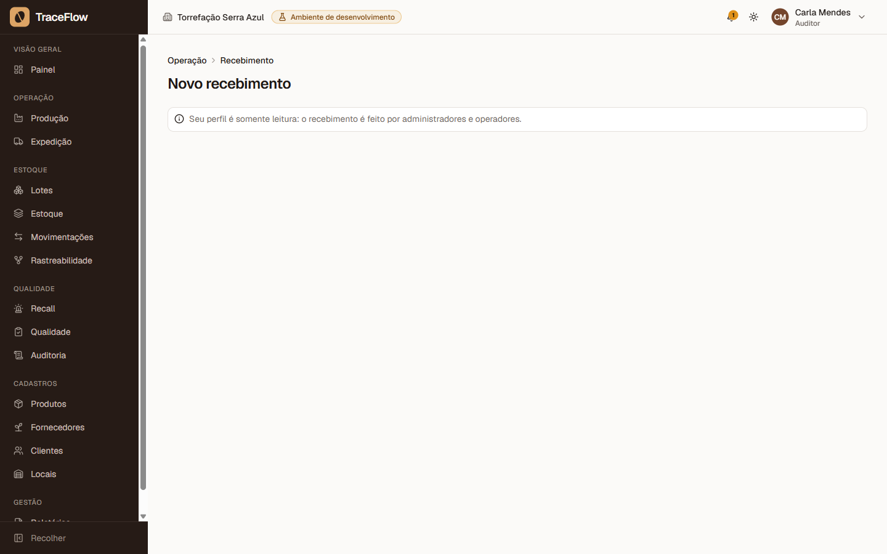

_Se o Auditor abrir um endereço de operação, vê um aviso de somente leitura._

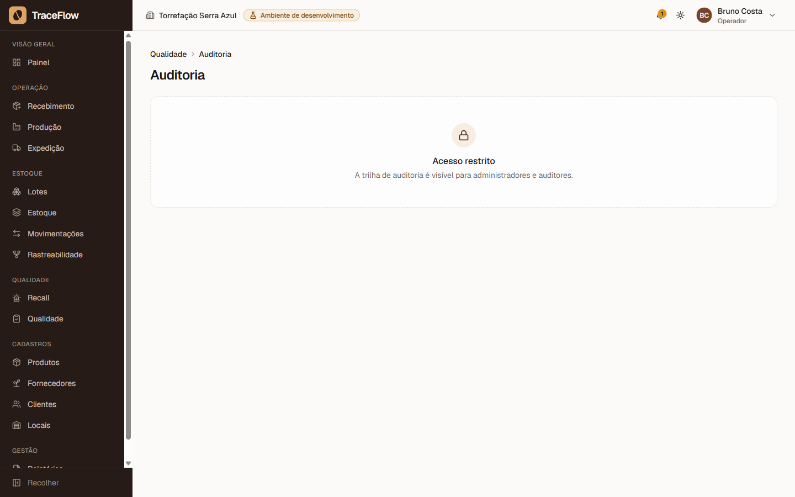

_O **Operador** não tem acesso à Auditoria._

### 3.19 Uso no celular e tema escuro

O TraceFlow se adapta ao celular e ao tablet: o menu vira um botão no canto superior esquerdo e as tabelas viram listas de cartões.

| Painel no celular                                             | Menu aberto no celular                                                    |
| ------------------------------------------------------------- | ------------------------------------------------------------------------- |
|  |  |

_Painel e menu no celular._

O botão de **tema** (sol/lua, no cabeçalho) alterna entre **Claro**, **Escuro** e **Sistema** (segue a configuração do aparelho). A escolha fica salva no navegador.


_Rastreabilidade no tema escuro._

---

## 4. Mensagens do sistema e como resolver erros comuns

**Mensagens de sucesso** aparecem num quadro verde no canto superior direito (ex.: _"Lote CAF-2026-000007 recebido"_, _"NC-2026-000001 liberada"_). **Erros de preenchimento** aparecem em vermelho, logo abaixo do campo. **Erros gerais** aparecem num aviso no topo do formulário.


_Exemplo de erro: tentar dar saída de 20 sacas de um lote que tem 12. O sistema avisa antes de enviar._

| Mensagem                                                                                                                       | O que significa                                                                                | Como resolver                                                                                           |
| ------------------------------------------------------------------------------------------------------------------------------ | ---------------------------------------------------------------------------------------------- | ------------------------------------------------------------------------------------------------------- |
| **Saldo insuficiente em [local]: disponível X**                                                                                | A quantidade é maior que o saldo naquele local (talvez outro usuário tenha movimentado o lote) | Confira o saldo atualizado (o sistema recarrega) e ajuste a quantidade ou escolha outro local           |
| **Lote em quarentena/bloqueado não pode ser movimentado**                                                                      | O status do lote impede a operação                                                             | Resolva a NC ou peça a um administrador para mudar o status                                             |
| **Esta movimentação já foi estornada**                                                                                         | Alguém já estornou essa linha                                                                  | Nenhuma ação: confira o histórico                                                                       |
| **Já existe um cadastro com este valor**                                                                                       | SKU, código ou documento repetido                                                              | Use outro código ou edite o cadastro existente                                                          |
| **CPF ou CNPJ inválido.**                                                                                                      | Dígitos verificadores não conferem                                                             | Revise o número                                                                                         |
| **Alguns campos estão inválidos. Revise o formulário.**                                                                        | Há campos obrigatórios vazios ou fora da faixa                                                 | Corrija os campos marcados em vermelho                                                                  |
| **O produto está inativo.** / **O local de destino está inativo.** / **O cliente está inativo e não pode receber expedições.** | O cadastro foi desativado                                                                      | Peça a um administrador para reativar, ou escolha outro                                                 |
| **A saída não pode exceder a massa de entrada.**                                                                               | Na produção, a saída é maior que a soma dos insumos (em kg)                                    | Revise as quantidades da ordem                                                                          |
| **Sua sessão expirou. Entre novamente.**                                                                                       | Tempo de sessão encerrado                                                                      | Entre de novo; você volta à mesma página                                                                |
| **Você não tem permissão para esta ação.** / **Acesso restrito**                                                               | Seu perfil não permite a ação                                                                  | Peça a um administrador                                                                                 |
| **Registro não encontrado.**                                                                                                   | O registro não existe ou não pertence à sua empresa                                            | Confira o código ou o link                                                                              |
| **Você está sem conexão**                                                                                                      | Internet caiu                                                                                  | Aguarde a conexão voltar; reenviar o mesmo formulário não duplica o registro                            |
| **Erro inesperado** (com um "ID da requisição")                                                                                | Falha no servidor                                                                              | Tente de novo; se persistir, envie o **ID da requisição** ao suporte — ele permite localizar o problema |

Uma página inexistente mostra uma tela própria, com atalho para voltar:


_Endereço inexistente: o menu continua disponível para seguir navegando._

---

## 5. Dúvidas frequentes

**Como acesso a aplicação?**
Pelo endereço informado pela equipe técnica, em qualquer navegador atualizado, no computador ou no celular. Não é preciso instalar nada. Veja [3.1](#31-como-entrar-no-sistema).

**Como ganho acesso / como cadastro um novo colega?**
Ainda não existe tela de cadastro de usuários. Solicite à equipe técnica, informando nome, e-mail e perfil (Administrador, Operador ou Auditor). A pessoa receberá uma senha temporária por e-mail.

**Esqueci minha senha.**
Use a opção de recuperação de senha da página de login, se estiver habilitada no seu ambiente; caso contrário, peça à equipe técnica para redefinir o acesso.

**Qual é o fluxo mais comum do dia a dia?**
Recebimento → (Produção) → Expedição. Veja [3.5](#35-recebimento-de-café), [3.9](#39-produção-beneficiamento-torra-blend-e-embalagem) e [3.10](#310-expedição-para-clientes).

**Lancei uma quantidade errada. Como apago?**
Não se apaga. Um administrador faz o **estorno** da movimentação (no histórico do lote) e você lança de novo, corretamente. Isso mantém o histórico confiável.

**Por que não consigo movimentar um lote?**
Verifique o status: em **quarentena**, ele só vai para um local de quarentena; **bloqueado** não sai. O aviso no topo do lote explica o motivo e como liberar.

**Como sei quais clientes receberam um lote?**
Abra o lote › **Rastreabilidade** › aba **Para frente (destino)**. Ou simule um recall — sem gravar nada.

**O recall avisa meus clientes automaticamente?**
Não. Ele gera a lista de clientes com e-mail, telefone e expedições, e o botão **Copiar lista** prepara o texto. O envio é feito pela sua equipe.

**Encerrei o recall, mas os lotes continuam bloqueados.**
É proposital: cada lote é liberado individualmente por um administrador, em **Alterar status**, depois de avaliado.

**Posso importar meu estoque atual de outra planilha?**
A importação aceita só cadastros (produtos, fornecedores, clientes e locais). O saldo inicial de cada lote deve ser lançado por **Recebimento**.

**O consumidor precisa de senha para ver a origem do café?**
Não. A página do QR code é pública e mostra só dados de origem, sem informações internas.

**Posso ver dados de outra empresa?**
Não. Cada empresa vê exclusivamente os próprios dados; um link de outra empresa responde "não encontrado".

**Como solicito suporte?**
Este projeto ainda não define um canal oficial de suporte (e-mail, telefone ou sistema de chamados). Combine esse canal com a equipe técnica responsável pela implantação. Ao relatar um erro, informe o que você fazia, a tela e, se aparecer, o **ID da requisição**.

---

## 6. Limitações conhecidas

| Limitação                                                                                                     | Impacto                                            | Alternativa atual                                 |
| ------------------------------------------------------------------------------------------------------------- | -------------------------------------------------- | ------------------------------------------------- |
| Sem tela de gestão de usuários e empresas                                                                     | Novos acessos dependem da equipe técnica           | Solicitar à equipe técnica                        |
| Recall não envia e-mail aos clientes                                                                          | Contato com clientes é manual                      | **Copiar lista** no detalhe do recall             |
| O aviso automático (recall e validade) vai para uma lista única de e-mails da equipe responsável pelo sistema | Cada empresa não recebe avisos próprios por e-mail | Acompanhar o sino de validade e a tela de Recall  |
| Quantidades no **PDF do recall** saem com 3 casas e unidade em código (ex.: `15.000 BAG_60KG` = 15 sacas)     | Leitura pode confundir                             | Usar a tela do recall como referência dos números |
| Importação só de cadastros                                                                                    | Estoque inicial precisa ser lançado                | Lançar por Recebimento                            |
| Sem integração com nota fiscal/ERP                                                                            | NF é registrada como texto                         | Exportar relatórios CSV                           |
| Sem exclusão de cadastros ou movimentações                                                                    | Proposital (rastreabilidade)                       | Desativar cadastros; estornar movimentações       |
| Anexos: só PDF, JPEG, PNG e WebP até 10 MB                                                                    | Outros formatos não são aceitos                    | Converter para PDF                                |
| Relatórios: até 20.000 linhas por arquivo                                                                     | Períodos muito longos são cortados                 | Baixar por períodos menores                       |
| Algumas mensagens técnicas podem aparecer em inglês em casos raros                                            | —                                                  | Informar o ID da requisição ao suporte            |

---

## 7. Encerramento

### Principais benefícios

- **Controle de estoque confiável:** saldo por lote e local, que nunca fica negativo, com histórico que não pode ser apagado.
- **Rastreabilidade completa em segundos:** da fazenda ao cliente, numa árvore visual.
- **Resposta rápida a problemas:** não conformidade com quarentena e recall com bloqueio automático, relatório em PDF e lista de clientes.
- **Transparência para o consumidor:** etiqueta com QR code e página pública de origem.
- **Pronto para auditorias:** trilha imutável de quem fez o quê, com antes e depois.
- **Simples de usar:** em português, no computador ou no celular, com permissões por perfil.

### Fluxo de utilização em resumo

```
 Cadastros          Recebimento         Produção                Expedição          Rastreabilidade
 (produtos,   ──▶   (cria o lote   ──▶  (torra, blend,    ──▶   (saída para   ──▶  (origem e destino,
 fornecedores,       e o saldo)          embalagem: novo         o cliente)         QR code, recall)
 clientes, locais)                       lote ligado aos
                                         insumos)
                           │
                           └── Qualidade a qualquer momento: não conformidade → quarentena → liberar/descartar
```

1. **Prepare os cadastros** (ou importe por planilha).
2. **Receba** o café: cada entrada vira um lote.
3. **Produza**: cada OP gera um lote novo ligado aos insumos.
4. **Expeça** para os clientes.
5. **Consulte** a rastreabilidade, imprima etiquetas e acompanhe o painel.
6. Em caso de problema, **abra uma NC** ou **simule e execute um recall**.

---

## 8. Glossário

| Termo                                       | Significado                                                                                                 |
| ------------------------------------------- | ----------------------------------------------------------------------------------------------------------- |
| **Lote**                                    | Quantidade de café com origem e características comuns, identificada por um código (ex.: `CAF-2026-000004`) |
| **Saldo**                                   | Quantidade atual de um lote num local                                                                       |
| **Razão / movimentações**                   | Histórico de todas as entradas e saídas                                                                     |
| **Estorno**                                 | Movimentação inversa que anula uma anterior, sem apagá-la                                                   |
| **OP (ordem de produção)**                  | Registro de uma etapa de beneficiamento, torra, blend ou embalagem                                          |
| **Rendimento**                              | Peso produzido ÷ peso consumido (na torra, normalmente de 75% a 90%)                                        |
| **Expedição (EXP)**                         | Envio de café a um cliente                                                                                  |
| **NC (não conformidade)**                   | Problema de qualidade registrado num lote                                                                   |
| **Quarentena**                              | Situação em que o lote fica retido até a análise                                                            |
| **Recall**                                  | Recolhimento de um lote e de todos os produtos feitos com ele                                               |
| **Rastreabilidade para trás / para frente** | Descobrir a origem / o destino de um lote                                                                   |
| **SKU**                                     | Código interno único de um produto                                                                          |
| **SCA**                                     | Pontuação de qualidade da _Specialty Coffee Association_ (0 a 100)                                          |
| **Saca (sc)**                               | Unidade de 60 kg de café verde                                                                              |
| **CSV**                                     | Formato de planilha simples, aberto pelo Excel                                                              |
| **QR code**                                 | Código lido pela câmera do celular que abre a página pública do lote                                        |
