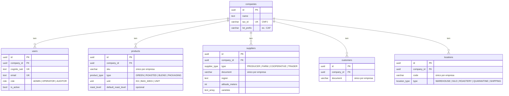

# Modelo de dados

Fonte da verdade: [`apps/api/prisma/schema.prisma`](../apps/api/prisma/schema.prisma). Migrations versionadas em `apps/api/prisma/migrations/`.

## Convenções

- Tabelas e colunas em `snake_case` (`@@map`/`@map`); modelos e campos no código em inglês/camelCase.
- IDs **UUID v7**: únicos globalmente, mas ordenáveis por tempo (índice B-tree eficiente, sem expor volume como um serial).
- Datas em `timestamptz(3)`.
- Toda tabela de negócio tem `company_id` (FK para `companies`, `ON DELETE RESTRICT`), e os únicos/índices **começam por ele** — as consultas sempre filtram por empresa, então o índice serve às duas coisas.
- Cadastros não são apagados: `is_active = false` (lotes vão referenciá-los a partir da Semana 2).
- Documentos (CPF/CNPJ) guardados só com dígitos.

## Diagrama (Semana 1)

## Decisões

- **`users.role`**: perfil _provisionado_. A autorização em runtime usa os grupos do token (`cognito:groups`); o emissor simulado gera os grupos a partir deste campo, e mais tarde ele serve para sincronizar grupos no Cognito.
- **Campos de qualidade do café no lote**: safra, umidade, peneira, pontuação e torra real variam a cada recebimento, então ficam em `lots` (Semana 2). No fornecedor ficam dados da origem (região, altitude, variedades); no produto, apenas o grau de torra padrão.
- **`lot_prefix` na empresa**: base do código de lote `CAF-2026-000123` (sequência por empresa na Semana 2).

## Seed

`pnpm --filter @traceflow/api db:seed` cria (de forma idempotente) duas empresas:

| Empresa                  | Prefixo | Usuários (e-mail → perfil)                                                                 |
| ------------------------ | ------- | ------------------------------------------------------------------------------------------ |
| Torrefação Serra Azul    | CAF     | ana@serraazul.dev → ADMIN · bruno@serraazul.dev → OPERATOR · carla@serraazul.dev → AUDITOR |
| Cooperativa Vale do Café | VDC     | diego@valedocafe.dev → ADMIN · elisa@valedocafe.dev → OPERATOR                             |

Com produtos (verde, torrado, blend, embalagem), fornecedores reais de regiões produtoras (Mantiqueira de Minas, Cerrado Mineiro, Alta Mogiana, Sul de Minas), clientes e locais. A segunda empresa existe para demonstrar e testar o isolamento.
