# Isolamento entre empresas (multi-tenancy)

Decisão: [ADR 0004](adr/0004-multi-tenancy.md). Código: `apps/api/src/tenancy/`. Testes: `apps/api/src/tenancy/tenant-scope.spec.ts` e `apps/api/test/tenancy.e2e-spec.ts`.

## Como a empresa chega até a consulta

```mermaid
flowchart LR
  req[Requisição] --> cls[ClsMiddleware<br/>abre contexto]
  cls --> guard[JwtAuthGuard]
  guard --> strat[JwtStrategy.validate<br/>TenantContext.set&#40;companyId&#41;]
  strat --> svc[Serviço de negócio]
  svc --> ext[TenantPrismaService.client<br/>extensão Prisma]
  ext -->|where/data com company_id| db[(Postgres)]
```

1. O `nestjs-cls` abre um contexto (AsyncLocalStorage) por requisição.
2. Após validar o token, a `JwtStrategy` grava `companyId` e `userId` no contexto — **a empresa vem do banco**, nunca do corpo ou de headers da requisição.
3. Serviços usam `TenantPrismaService.client`, cuja extensão reescreve cada operação com `scopeArgs()`.

## O que a extensão garante

| Operação                                                      | Regra                                                                  |
| ------------------------------------------------------------- | ---------------------------------------------------------------------- |
| `findUnique`, `update`, `delete`, `upsert`                    | `companyId` adicionado ao lado da chave única                          |
| `findMany`, `findFirst`, `count`, `updateMany`, `deleteMany`… | `{ AND: [where, { companyId }] }` — não dá para escapar com `OR`       |
| `create`, `createMany`                                        | `companyId` **forçado**; `companyId`/`company` do chamador descartados |
| `update`, `updateMany`, `upsert.update`                       | `companyId`/`company` removidos — registro nunca muda de empresa       |
| `Company`                                                     | Só a própria empresa; `create`/`delete` proibidos                      |
| Modelo sem `company_id` desconhecido                          | Erro (falha fechado)                                                   |
| Sem empresa no contexto                                       | Erro (falha fechado)                                                   |

Registro de outra empresa **não é encontrado** → o Prisma lança `P2025` → a API responde **404**, sem revelar que ele existe.

## Pontos cegos e como são tratados

| Ponto cego                           | Tratamento                                                                                                    |
| ------------------------------------ | ------------------------------------------------------------------------------------------------------------- |
| SQL bruto (`$queryRaw`)              | ESLint proíbe fora de `src/prisma` e `src/tenancy`; use `TenantPrismaService.sql(companyId => …)`             |
| Cliente sem filtro (`PrismaService`) | ESLint proíbe importá-lo em `src/modules/**`                                                                  |
| Escritas aninhadas (nested create)   | A partir da Semana 2, FKs compostas `(company_id, id)` garantem no banco que referências são da mesma empresa |
| Jobs e scripts fora de requisição    | `TenantContext.runAs(companyId, fn)`                                                                          |
| Defesa em profundidade               | Row-Level Security no Postgres — planejado para a revisão de segurança (Semana 5)                             |

## Armadilha: consultas lazy do Prisma

Consultas do Prisma só executam quando alguém chama `.then()`. Por isso `runAs` faz `return await fn()` **dentro** do contexto: se a promise fosse devolvida sem `await`, a consulta rodaria depois, fora do contexto — e seria recusada. Os testes de integração pegaram exatamente esse caso.

## Logs

Cada linha de log de uma requisição autenticada traz `companyId` e `userId`, além do `requestId`.
