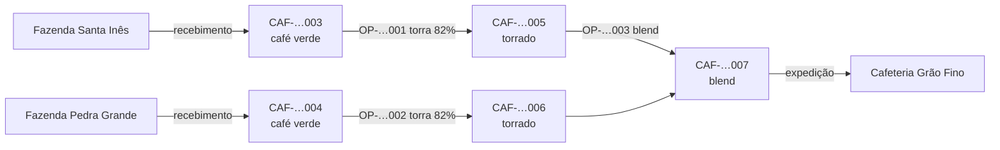

# Produção, genealogia e rastreabilidade (API)

Código: `apps/api/src/modules/production/` e `apps/api/src/modules/trace/`. Decisão de estoque: [ADR 0007](adr/0007-razao-de-estoque.md); genealogia: [ADR 0008](adr/0008-genealogia-e-rastreio-recursivo.md).

## A cadeia do café



Cada seta de produção é uma linha em `lot_origins` (filho, pai, quantidade, ordem). A colheita é o próprio lote recebido da fazenda (safra, variedade, altitude).

## Ordem de produção

`POST /v1/production-orders` (admin, operador; aceita `Idempotency-Key`)

```json
{
  "stage": "ROASTING",
  "inputs": [{ "lotId": "…", "locationId": "…", "quantity": "5" }],
  "outputProductId": "…",
  "outputLocationId": "…",
  "outputQuantity": "246",
  "lot": { "cuppingScore": 86.5, "expiresAt": "2027-04-30" },
  "notes": "Torrador 2, perfil 12 min"
}
```

Numa única transação: número `OP-AAAA-NNNNNN` → código do lote novo → `CONSUMPTION` de cada insumo (travando os lotes **em ordem fixa** para evitar deadlock) → `PRODUCTION` do lote novo → `lot_origins`. Qualquer falha (saldo, status, regra) desfaz tudo.

| Etapa        | Insumos aceitos           | Produto gerado   |
| ------------ | ------------------------- | ---------------- |
| `PROCESSING` | café verde                | café verde       |
| `ROASTING`   | café verde                | torrado          |
| `BLENDING`   | torrado, blend            | blend            |
| `PACKAGING`  | torrado, blend, embalagem | torrado ou blend |

- **Rendimento** = massa de saída ÷ massa de entrada (kg; 1 saca = 60 kg). Embalagens e unidades ficam fora. Saída maior que a entrada → 400.
- **Herança**: o lote gerado herda safra e variedade quando todos os insumos coincidem (um blend de origens diferentes fica sem variedade); grau de torra padrão vem do produto.
- Saída em local de quarentena → lote nasce em quarentena.
- Correção: estorno das movimentações (a genealogia é só de inclusão, como o razão).

Listagem `GET /v1/production-orders` (filtros `stage`, `q`, `from`, `to`) e detalhe com insumos, lote gerado, massas, rendimento e perda.

## Rastreabilidade

| Rota                              | Resposta                                                                                                                                               |
| --------------------------------- | ------------------------------------------------------------------------------------------------------------------------------------------------------ |
| `GET /v1/lots/:id/trace/backward` | `nodes` (lotes, com `depth` 0 = o próprio), `edges` (pai → filho, quantidade, ordem e etapa), `origins` (fazendas/fornecedores distintos), `truncated` |
| `GET /v1/lots/:id/trace/forward`  | `nodes`, `edges`, `shipments` (expedições do lote e de todos os derivados), `customers` (clientes distintos — base do recall), `truncated`             |

- Consultas `WITH RECURSIVE` sobre `lot_origins`, sempre filtradas por `company_id`.
- O caminho percorrido (`path`) impede ciclos; profundidade máxima 20 (busca-se um nível a mais para preencher `truncated`).
- Cada aresta aparece uma vez, na menor profundidade (`DISTINCT ON`), mesmo em grafos em diamante.
