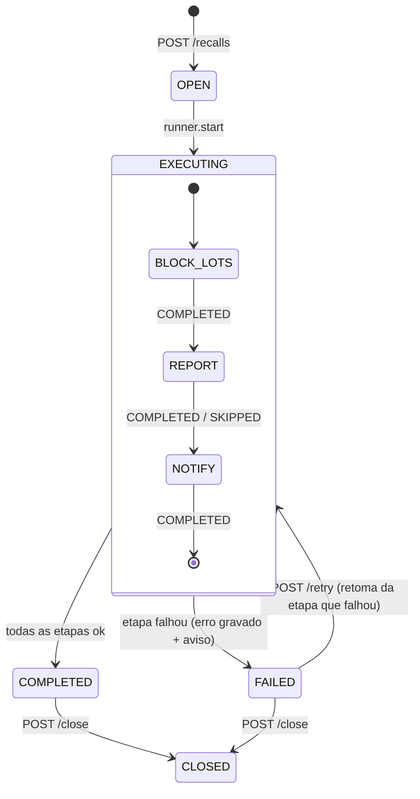

# Recall, qualidade e auditoria (Semana 4)

Decisão: [ADR 0009](adr/0009-recall-orquestrado.md). Código: `apps/api/src/modules/{recalls,non-conformities,alerts,audit}`, `apps/api/src/notifications/`, `apps/api/src/jobs/`.

## Recall

### Rotas

| Rota                         | Perfis                   | O que faz                                                        |
| ---------------------------- | ------------------------ | ---------------------------------------------------------------- |
| `POST /v1/recalls/simulate`  | admin, operador, auditor | Impacto sem gravar nada: lotes (com saldo), expedições, clientes |
| `POST /v1/recalls`           | admin                    | Cria (`RC-AAAA-NNNNNN`) e executa o workflow                     |
| `POST /v1/recalls/:id/retry` | admin                    | Retoma um recall `FAILED` a partir da etapa que falhou           |
| `POST /v1/recalls/:id/close` | admin                    | Encerra com notas (`COMPLETED`/`FAILED` → `CLOSED`)              |
| `GET /v1/recalls`            | todos                    | Lista paginada (filtros `status`, `lotId`)                       |
| `GET /v1/recalls/:id`        | todos                    | Detalhe: etapas, lotes (status anterior), clientes com contato   |
| `GET /v1/recalls/:id/report` | todos                    | URL pré-assinada do PDF (404 se o relatório ainda não existe)    |

### Impacto

- **Para frente** (`TraceService.forward`): o lote de origem e todos os derivados (torrado, blend, embalado) e as expedições desses lotes → clientes.
- **Para trás** (`TraceService.backward`): fazendas de origem, só para informação no relatório.
- Lotes "irmãos" (outros cafés do mesmo blend) **não** entram: o problema está no lote de origem e no que foi feito com ele.
- Na criação, o impacto vira uma fotografia em `recall_lots` (profundidade, saldo) e `recall_customers` (expedições, quantidade por unidade).

### Workflow

| Etapa        | O que faz                                                                                                               | Idempotência                                   |
| ------------ | ----------------------------------------------------------------------------------------------------------------------- | ---------------------------------------------- |
| `BLOCK_LOTS` | Uma transação: trava os lotes em ordem de id (`FOR UPDATE`), grava o status anterior e põe `BLOCKED` (com ou sem saldo) | Só lotes com `blocked_at` nulo                 |
| `REPORT`     | PDF (pdf-lib) com número, motivo, origem, lotes e clientes a contatar → `{companyId}/recalls/{id}.pdf`                  | Sobrescreve o mesmo objeto; sem S3 → `SKIPPED` |
| `NOTIFY`     | Aviso pelo `Notifier` com lotes bloqueados e clientes a contatar                                                        | Etapa concluída não é refeita                  |

Cada etapa grava `status`, `attempts`, `started_at`, `finished_at`, `error` e `output` em `recall_steps`. Falha: etapa `FAILED`, recall `FAILED` com `last_error`, auditoria `recall.failed` e aviso `recall.failed`.

### Local × AWS

| Ambiente | Runner                       | Como roda                                                                                                 |
| -------- | ---------------------------- | --------------------------------------------------------------------------------------------------------- |
| Local    | `LocalRecallRunner` (padrão) | Etapas em sequência dentro da própria requisição; a resposta já vem `COMPLETED` (ou `FAILED`)             |
| AWS      | `StepFunctionsRecallRunner`  | Com `RECALL_STATE_MACHINE_ARN`: `StartExecution`; a resposta vem `EXECUTING` e o progresso aparece no GET |

Contrato com a infraestrutura:

- Entrada da execução: `{ "recallId", "companyId", "steps": ["BLOCK_LOTS", "REPORT", "NOTIFY"] }`.
- Cada estado invoca a Lambda `apps/api/src/jobs/recall-step.job.ts` (`handler`) com `{ recallId, companyId, step }` e recebe `{ recallId, step, status }`.
- `status` `COMPLETED`/`SKIPPED` → próximo estado; `FAILED` → encerrar (o recall já está `FAILED` e avisado). A Lambda só lança em entrada inválida ou erro de infraestrutura (aí o retry do Step Functions faz sentido, porque a etapa é idempotente).
- A Lambda confere que o recall pertence à empresa do evento e roda em `TenantContext.runAs` com o usuário que abriu o recall.

### Regras

- No máximo **um recall não encerrado por lote de origem** (409 `/problems/recall-already-open`; índice único parcial no banco).
- Enquanto o lote estiver num recall não encerrado, voltar a `AVAILABLE` é recusado (409 `/problems/lot-under-recall`) — pela troca de status e pela liberação de NC.
- Encerrar o recall **não libera** os lotes: continuam `BLOCKED`; a liberação é explícita, lote a lote (`PATCH /lots/:id/status`).

## Não conformidade e quarentena

| Rota                                    | Perfis          | O que faz                                                                               |
| --------------------------------------- | --------------- | --------------------------------------------------------------------------------------- |
| `POST /v1/non-conformities`             | admin, operador | Abre `NC-AAAA-NNNNNN` (tipo: umidade, defeitos, contaminação, pragas, embalagem, outro) |
| `POST /v1/non-conformities/:id/release` | admin           | Libera com justificativa                                                                |
| `POST /v1/non-conformities/:id/discard` | admin           | Descarta com justificativa                                                              |
| `GET /v1/non-conformities[/:id]`        | todos           | Lista paginada (filtros `status`, `type`, `lotId`) e detalhe                            |

- **Abrir**: lote `AVAILABLE` → `QUARANTINE`. Lote `BLOCKED`/`CONSUMED` mantém o status (a NC só é registrada). Quarentena impede saída e transferência (exceto para área de quarentena).
- **Liberar**: NC `RELEASED`. O lote volta a `AVAILABLE` só se estava em `QUARANTINE`, não há outra NC aberta e não está num recall aberto (senão, 409 `lot-under-recall`).
- **Descartar**: NC `DISCARDED`; para cada local com saldo, um `ADJUSTMENT` de perda pelo razão (documento = número da NC, motivo = justificativa) e o lote termina `CONSUMED`. Única exceção à regra "lote retido não sai do lugar" (flag interna `allowRestrictedLot`, nenhuma rota pública a expõe).
- Tudo numa transação, com a NC e o lote travados (`FOR UPDATE`); resolver duas vezes → 409 `/problems/non-conformity-not-open`.

## Alertas de validade

- `GET /v1/alerts/expiring?days=30` (todos os perfis): lotes **com saldo** vencidos ou vencendo na janela, ordenados pela data; `daysToExpiry` negativo = vencido. Padrão: `ALERT_EXPIRY_DAYS` (30); máximo 365.
- Job `apps/api/src/jobs/expiry-alert.job.ts` (`handler`, EventBridge Scheduler, sem entrada): para cada empresa, calcula a lista e avisa pelo `Notifier` (empresa sem lotes na janela não recebe aviso). Falha numa empresa não impede as outras.

## Notificações

`Notifier` com duas implementações: `SnsNotifier` (com `SNS_TOPIC_ARN`; assunto ASCII ≤ 99 caracteres, atributos `event` e `companyId`) e `LogNotifier` (padrão local: o aviso vira uma linha de log). Eventos: `recall.executed`, `recall.failed`, `lots.expiring`.

## Auditoria

Tabela `audit_logs` (só inclusão: trigger no banco + extensão de tenant): empresa, usuário (null em jobs), `action`, `entity_type`, `entity_id`, `before`/`after` (JSON), `request_id`, `ip`, data.

- **Explícita**, na mesma transação da operação: `lot.received`, `lot.updated` (antes/depois dos campos enviados), `lot.status_changed`, `movement.created`, `movement.reversed`, `production_order.created`, `shipment.created`, `company.updated`, `label.generated`, `non_conformity.opened|released|discarded`, `recall.created|started|retried|executed|failed|closed`.
- **Rede de segurança**: um interceptor global grava `http.post|put|patch|delete` (rota + id do resultado) para toda escrita autenticada e bem-sucedida que o serviço não auditou; repetições idempotentes são ignoradas. Não guarda corpo de requisição nem resposta.
- `request_id` e IP entram no contexto (CLS) na abertura da requisição (`x-request-id`; IP do primeiro `x-forwarded-for` ou do socket — informativo). Jobs usam `job:expiry-alert:…` e `sfn:{recallId}:{step}`.
- **Retenção** (`AUDIT_RETENTION_DAYS`, padrão 1825 dias = 5 anos, mínimo 366): o job mensal `audit-retention` (Scheduler, dia 1 às 03:00) arquiva os registros mais antigos no bucket, em `<empresa>/audit-archive/<data>_<último id>.jsonl.gz` (JSON Lines + gzip, lotes de 5.000), e só depois os remove, na mesma transação. O trigger continua proibindo `UPDATE` sempre e só aceita `DELETE` com a flag `traceflow.audit_retention` ligada na transação **e** para registros com mais de 1 ano. Sem bucket configurado, nada é apagado; se o upload falhar, nada é apagado.
- `GET /v1/audit-logs` (admin, auditor): paginado, filtros `entityType`, `entityId`, `userId`, `action` (exata, ou prefixo terminado em ponto, ex.: `recall.`), `from`/`to`; inclui o nome do usuário.

## Central de avisos (no app)

Os avisos de `recall.executed`, `recall.failed` e `lots.expiring` (que também saem pelo SNS) e o de `non_conformity.opened` (só no app) ficam na **central de avisos** do cabeçalho: um registro por destinatário na tabela `notifications`.

| Categoria | Eventos                            | Quem recebe               |
| --------- | ---------------------------------- | ------------------------- |
| `recall`  | `recall.executed`, `recall.failed` | admin, operador e auditor |
| `expiry`  | `lots.expiring` (job diário)       | admin e operador          |
| `quality` | `non_conformity.opened`            | admin e operador          |

- Cada usuário vê só os próprios avisos (`GET /v1/notifications`, `unread-count`, `POST /{id}/read`, `read-all`); aviso de outro usuário ou empresa responde 404.
- Cada usuário pode silenciar categorias (`GET/PUT /v1/notifications/preferences`, coluna `users.muted_notifications`).
- O sino mostra os não lidos e atualiza a cada minuto; no topo da lista fica o resumo **ao vivo** dos lotes vencendo em 30 dias.
- E-mail continua pelo tópico SNS da operação (`notification_emails` no Terraform). E-mail individual por usuário exigiria o SES com domínio verificado, que fica fora do free tier deste projeto.

## Variáveis de ambiente

| Variável                   | Padrão | Uso                                                   |
| -------------------------- | ------ | ----------------------------------------------------- |
| `SNS_TOPIC_ARN`            | —      | Avisos via SNS; vazio → log                           |
| `RECALL_STATE_MACHINE_ARN` | —      | Recall orquestrado pelo Step Functions; vazio → local |
| `ALERT_EXPIRY_DAYS`        | `30`   | Janela padrão do alerta de validade                   |
| `AUDIT_RETENTION_DAYS`     | `1825` | Retenção da auditoria antes de arquivar no bucket     |

## Testes

Cobertos em `apps/api/test/recall-quality.e2e-spec.ts`, `tenancy-resources.e2e-spec.ts` e `audit-retention.e2e-spec.ts`: retomada de etapa, retries simultâneos, descarte com saldo em vários locais, resolução concorrente de NC, isolamento por empresa, trigger de `audit_logs` e retenção. Os handlers dos jobs na Lambda ainda não têm teste automatizado.
